# Production-Ready, Highly Available, Multi-Tenant PostgreSQL on Docker & Kubernetes

### A step-by-step guide for DBAs who are just starting out, using a Payment Gateway as the worked example

> **Who this is for:** You know basic SQL and have used `docker` and `kubectl` a little. You have **not** run PostgreSQL in production before. By the end you will understand *why* each piece exists and have working commands, manifests and SQL for every step.
>
> **Version baseline:** PostgreSQL **17** (everything here also works on 18, and the guide points out where 18 helps). On Kubernetes we use the **CloudNativePG (CNPG)** operator. Check the operator and plugin release pages for the current versions before you install. This guide uses `${VERSION}` placeholders on purpose so you don't copy an old version number.

---

## Table of Contents

0. [How to Use This Guide](#0-how-to-use-this-guide)
1. [Core Concepts Primer (Read This First)](#1-core-concepts-primer-read-this-first)
2. [Target Architecture at a Glance](#2-target-architecture-at-a-glance)
3. [Multi-Tenancy Design](#3-multi-tenancy-design)
4. [Payment Gateway Data Model (Tables, Keys, Row-Level Security)](#4-payment-gateway-data-model)
5. [Load Distribution: Routing Reads and Writes](#5-load-distribution-routing-reads-and-writes)
6. [Hands-On Lab 1: Primary + Standby + Replica with Docker](#6-hands-on-lab-1-primary--standby--replica-with-docker)
7. [Production on Kubernetes with CloudNativePG](#7-production-on-kubernetes-with-cloudnativepg)
8. [Creating and Maintaining Standbys and Replicas](#8-creating-and-maintaining-standbys-and-replicas)
9. [Connection Pooling Step by Step](#9-connection-pooling-step-by-step)
10. [Partitioning Step by Step](#10-partitioning-step-by-step)
11. [Query Optimization Strategies](#11-query-optimization-strategies)
12. [Materialized Views: Build, Refresh, Secure, Maintain](#12-materialized-views-build-refresh-secure-maintain)
13. [PostgreSQL Performance Tuning for High Load](#13-postgresql-performance-tuning-for-high-load)
14. [Backups, Point-in-Time Recovery and Disaster Recovery](#14-backups-point-in-time-recovery-and-disaster-recovery)
15. [Monitoring and Alerting](#15-monitoring-and-alerting)
16. [Day-2 Operations Runbook](#16-day-2-operations-runbook)
17. [Scaling Beyond One Cluster (Tenant Cells / Sharding)](#17-scaling-beyond-one-cluster)
18. [Production Readiness Checklist](#18-production-readiness-checklist)
19. [Appendix: Command Cheat Sheet](#19-appendix-command-cheat-sheet)

---

## 0. How to Use This Guide

Work through it in this order:

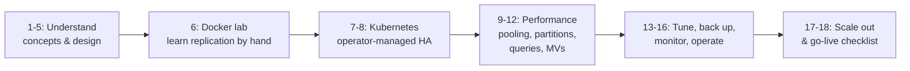

**Why a Docker lab before Kubernetes?** On Kubernetes, the operator does replication, failover and backups for you. That's great in production but bad for learning, because you never see the mechanics. Doing it by hand once in Docker means that when something breaks at 3 a.m. you'll know what the operator was doing for you.

**Conventions**

| Symbol | Meaning |
|---|---|
| `$` | Run in your laptop's shell |
| `postgres=#` / `payments=>` | Run inside `psql` |
| 🟢 | Safe to run any time |
| 🟡 | Changes state, so run it in a maintenance window or understand it first |
| 🔴 | Destructive or risky. Read twice. |

---

## 1. Core Concepts Primer (Read This First)

### 1.1 The vocabulary you'll hear every day

| Term | Plain-English meaning | Why you care |
|---|---|---|
| **Primary** | The single server that accepts writes. | Every `INSERT/UPDATE/DELETE` goes here. |
| **Standby** | A copy of the primary that continuously replays its changes. It can be **promoted** to primary. | Your failover target. |
| **Hot standby / Read replica** | A standby that also answers **read-only** queries. | Offloads reads from the primary. |
| **WAL (Write-Ahead Log)** | A sequential journal of every change. It's written *before* data files change. | Crash recovery, replication and point-in-time recovery all come from WAL. |
| **LSN (Log Sequence Number)** | A position in the WAL, like `0/3000148`. | Used to measure replication lag in bytes. |
| **Streaming replication** | The primary streams WAL records to standbys over a TCP connection. | Near-real-time copies. |
| **Synchronous replication** | The primary waits for at least one standby to confirm before telling the client "committed". | **Zero data loss** on failover (RPO = 0) at the cost of a little latency. |
| **Asynchronous replication** | The primary doesn't wait. | Faster, but you can lose the last few transactions on failover. |
| **Replication slot** | A bookmark on the primary that guarantees WAL is kept until a standby has consumed it. | Prevents a standby from falling too far behind, but can **fill your disk** if a standby dies. |
| **Failover** | *Unplanned* promotion of a standby because the primary died. | Automated by the operator. |
| **Switchover** | *Planned* role swap (for patching, for example). | Zero data loss, a few seconds of write pause. |
| **Split-brain** | Two nodes both think they're primary and accept writes. | Catastrophic for a payment system. Fencing prevents it. |
| **RPO** (Recovery Point Objective) | How much data you may lose. | Payments target **RPO = 0**. |
| **RTO** (Recovery Time Objective) | How long you may be down. | Target **< 30–60 s** for automatic failover. |
| **PITR** (Point-in-Time Recovery) | Restore the database to any second in the past using a base backup plus archived WAL. | Your undo button for `DELETE FROM payments;` mistakes. |
| **MVCC / VACUUM** | PostgreSQL keeps old row versions for concurrency. `VACUUM` cleans them up. | Neglected vacuum means bloat and slow queries. |

### 1.2 How a commit becomes durable

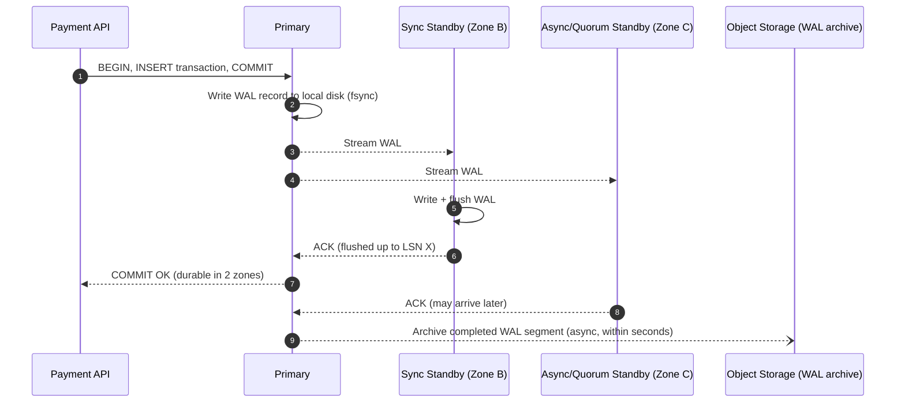

The **commit only returns after two copies exist in two different failure zones**. That's what makes a payment "durable".

### 1.3 The three properties you asked for, mapped to features

| Goal | Features that deliver it |
|---|---|
| **Stable** | Connection pooling, resource limits, timeouts, partitioning (keeps tables and indexes small), autovacuum tuning |
| **Reliable** | 3-node cluster across zones, automatic failover, fencing, health probes, tested switchovers |
| **Durable** | Synchronous replication, `fsync`/`full_page_writes` on, data checksums, continuous WAL archiving, PITR, cross-region DR replica |
| **Maintainable** | Operator-managed (declarative YAML in Git), `pg_partman` and `pg_cron` automation, monitoring, runbooks |

---

## 2. Target Architecture at a Glance

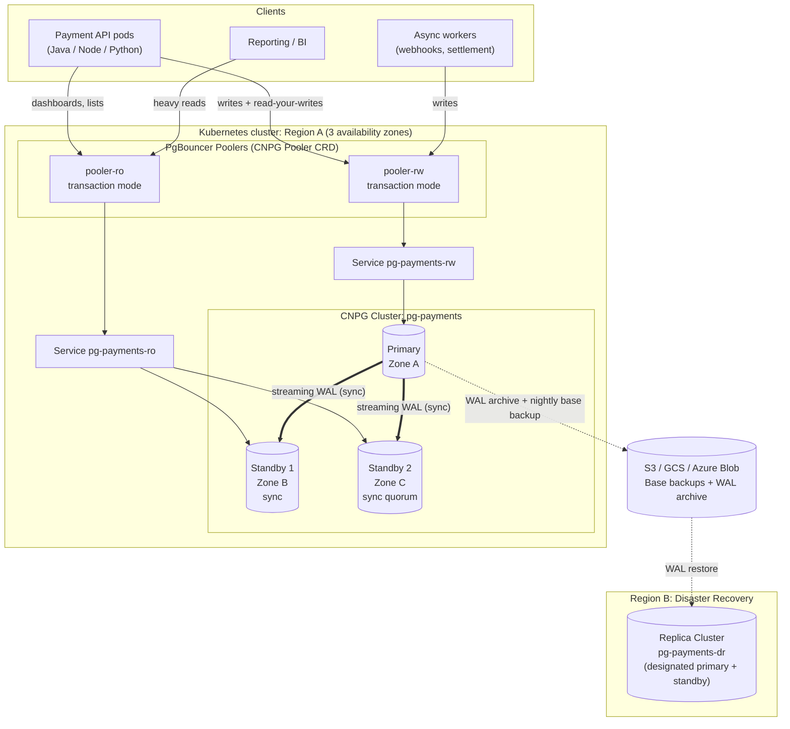

**What each piece does**

* **3 PostgreSQL instances, one per availability zone.** You can lose a whole zone and keep running.
* **Quorum synchronous replication** (`ANY 1 (standby1, standby2)`). Every commit is on at least 2 nodes. If one standby is down, the other keeps commits flowing.
* **CloudNativePG operator.** Watches health, does automatic failover, re-points Services, rebuilds failed nodes, runs backups.
* **Two PgBouncer poolers.** One for read-write traffic, one for read-only. Thousands of app connections fan into a few dozen real database connections.
* **Object storage.** Continuous WAL archive plus base backups, giving PITR to any second within your retention window.
* **DR replica cluster** in another region. It replays WAL from object storage (and optionally streams). You promote it if Region A is lost.

---

## 3. Multi-Tenancy Design

A **tenant** in a payment gateway is a **merchant** (or a platform/sub-aggregator that onboards merchants). Every row of business data belongs to exactly one tenant, and **one tenant must never see another tenant's data**. In payments, a leak is a regulatory incident.

### 3.1 The three models

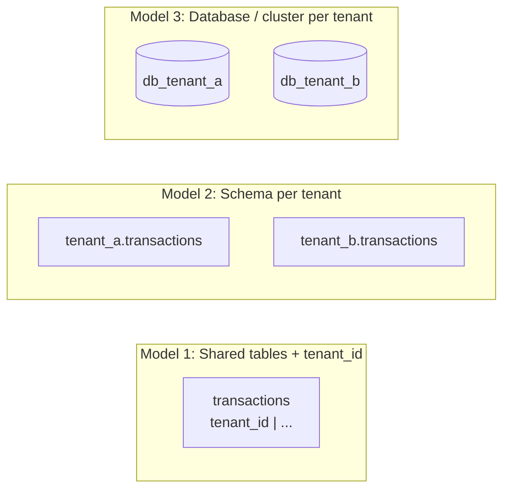

| | **Shared tables + `tenant_id` + RLS** | **Schema per tenant** | **Database or cluster per tenant** |
|---|---|---|---|
| Isolation | Logical (enforced by Row-Level Security) | Medium | Strong (physical) |
| Tenants supported | 100,000+ | ~1,000s (catalog bloat beyond that) | 10s–100s |
| Schema migrations | One migration | N migrations | N migrations |
| Connection pooling | Excellent (one pool) | Poor (`search_path` per tenant) | Poor (pool per DB) |
| Cross-tenant reporting | Easy | Hard | Very hard |
| Noisy-neighbour risk | Highest, so needs partitioning, indexes and limits | Medium | None |
| Cost | Lowest | Medium | Highest |

### 3.2 Recommended: hybrid "pooled + silo" tiers

Most payment platforms use **Model 1 for the long tail** and **Model 3 for the very large merchants**, with a routing table that decides where each tenant lives:

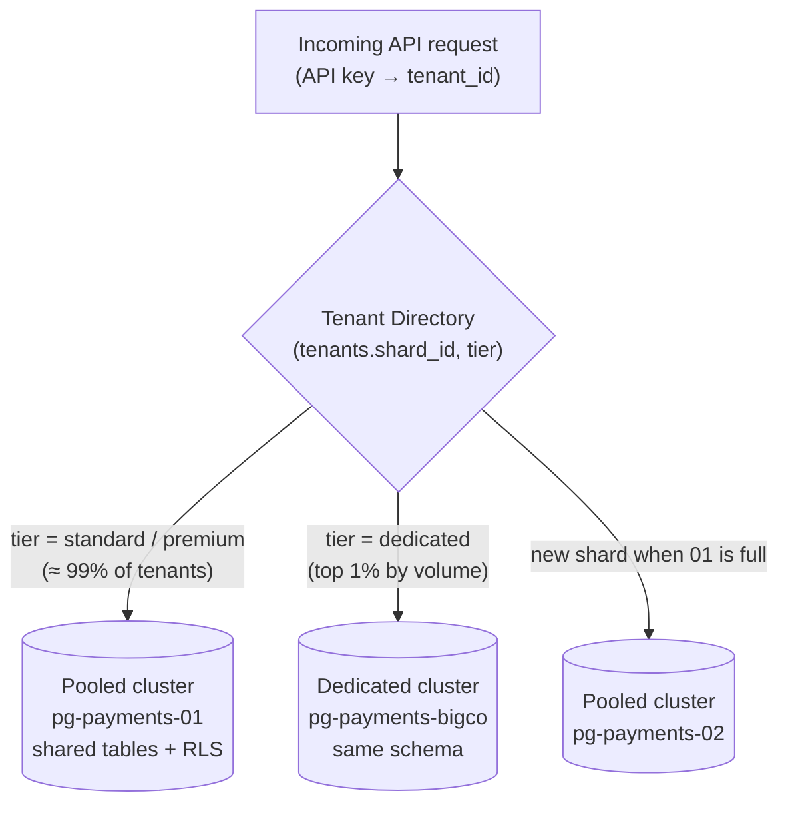

The **schema is identical everywhere**, so moving a tenant from pooled to dedicated is a data copy, not a code change. The rest of this guide builds the **pooled cluster**. A dedicated cluster is the same YAML with a different name.

### 3.3 The golden rules for shared-table multi-tenancy

1. **Every tenant-owned table has `tenant_id NOT NULL`.**
2. **`tenant_id` is the first column of almost every index and composite primary key.** Queries then touch only that tenant's slice of the B-tree.
3. **Row-Level Security (RLS) is enabled and `FORCE`d** on every tenant table, so even a buggy query without `WHERE tenant_id = …` can't leak data.
4. **The application role is not the table owner and does not have `BYPASSRLS`.**
5. **The tenant is set per transaction** with `SET LOCAL app.tenant_id = '…'`. This is compatible with PgBouncer transaction pooling, because the setting disappears at `COMMIT`.

---

## 4. Payment Gateway Data Model

### 4.1 Tables and their "temperature"

Not all tables are equal. Classify each one by how hot it is and how fast it grows. This drives partitioning, indexing and routing decisions.

| Table | Purpose | Write rate | Read pattern | Growth | Strategy |
|---|---|---|---|---|---|
| `tenants` | Merchants / tenants | Very low | Every request (cached) | Tiny | Plain table, cache in app |
| `api_keys` | Hashed API credentials | Low | Every request (cached) | Small | Plain table |
| `customers` | Merchant's end customers | Medium | Point lookups | Medium | Plain table, `(tenant_id, …)` keys |
| `payment_methods` | **Tokens only**, never raw card numbers (PCI DSS) | Medium | Point lookups | Medium | Plain table |
| `payment_orders` | Payment intent / order | **High** | Point + list | Large | **Partition by month** |
| `transactions` | Each auth/capture/void attempt | **Very high** | Point + list + reports | Very large | **Partition by month** |
| `transaction_events` | State-machine history | **Very high** (append-only) | By txn | Huge | **Partition by month**, BRIN index |
| `refunds` | Refunds | Medium | Point + list | Medium | Plain table or partition |
| `idempotency_keys` | De-duplicate retried API calls | **Very high** | Point lookup on every write | Rolling 24–72 h | Plain table + TTL purge (or daily partitions) |
| `ledger_entries` | Double-entry accounting | **Very high** (append-only) | Balances, statements | Huge | **Partition by month** |
| `settlements` / `settlement_items` | Payouts to merchants | Batch | Reports | Large | Partition by month |
| `webhook_outbox` | Reliable event delivery (outbox pattern) | **Very high** | Queue (`SKIP LOCKED`) | Rolling | Plain table, aggressive autovacuum |
| `audit_log` | Who did what | High | Rare | Huge | **Partition by month**, archive old ones |

### 4.2 Entity-relationship diagram

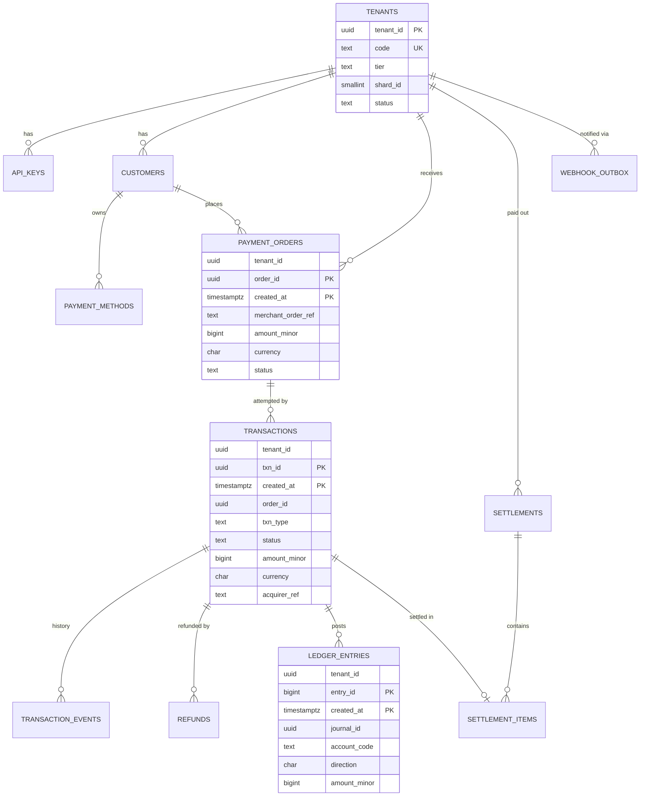

> **Money rule:** store amounts as **integers in minor units** (`bigint amount_minor`, so ₹100.50 = `10050`) plus a `currency char(3)`. Never use `float`. `numeric` works but is slower.

### 4.3 Step 1: create roles (least privilege)

Run as the database owner/superuser. On Kubernetes, CNPG can create these roles declaratively (Section 7.6). The SQL is shown here so you understand what gets created.

```sql
-- 🟡 Roles (NOLOGIN "group" roles + LOGIN users that inherit them)
CREATE ROLE payments_owner NOLOGIN;              -- owns all objects; used only by migrations
CREATE ROLE app_rw NOLOGIN NOBYPASSRLS;          -- what the API uses
CREATE ROLE app_ro NOLOGIN NOBYPASSRLS;          -- read-only API endpoints
CREATE ROLE platform_reporting NOLOGIN BYPASSRLS;-- internal cross-tenant reporting ONLY

CREATE ROLE migrator   LOGIN PASSWORD 'change-me' IN ROLE payments_owner;
CREATE ROLE api_user   LOGIN PASSWORD 'change-me' IN ROLE app_rw;
CREATE ROLE api_reader LOGIN PASSWORD 'change-me' IN ROLE app_ro;
CREATE ROLE bi_user    LOGIN PASSWORD 'change-me' IN ROLE platform_reporting;

-- Safety nets per role (these stop runaway queries from hurting everyone)
ALTER ROLE api_user   SET statement_timeout = '5s';
ALTER ROLE api_user   SET lock_timeout = '2s';
ALTER ROLE api_user   SET idle_in_transaction_session_timeout = '10s';
ALTER ROLE api_reader SET statement_timeout = '10s';
ALTER ROLE bi_user    SET statement_timeout = '15min';
ALTER ROLE migrator   SET lock_timeout = '3s';   -- migrations fail fast instead of queueing behind traffic

-- The owner role needs to own the database so it can create schemas
-- (CNPG does this for you through bootstrap.initdb.owner)
ALTER DATABASE payments OWNER TO payments_owner;
```

### 4.4 Step 2: create the schema and core tables

```sql
-- 🟡 Run as migrator (member of payments_owner)
SET ROLE payments_owner;
CREATE SCHEMA IF NOT EXISTS pay AUTHORIZATION payments_owner;
SET search_path = pay, public;

-- ---------- Tenants (global, not RLS-protected; app caches this) ----------
CREATE TABLE pay.tenants (
    tenant_id     uuid PRIMARY KEY DEFAULT gen_random_uuid(),
    code          text NOT NULL UNIQUE,
    legal_name    text NOT NULL,
    tier          text NOT NULL DEFAULT 'standard'
                  CHECK (tier IN ('standard','premium','dedicated')),
    shard_id      smallint NOT NULL DEFAULT 1,
    status        text NOT NULL DEFAULT 'active'
                  CHECK (status IN ('active','suspended','closed')),
    settlement_currency char(3) NOT NULL DEFAULT 'INR',
    created_at    timestamptz NOT NULL DEFAULT now()
);

CREATE TABLE pay.api_keys (
    tenant_id   uuid NOT NULL REFERENCES pay.tenants(tenant_id),
    key_id      uuid NOT NULL DEFAULT gen_random_uuid(),
    key_prefix  text NOT NULL UNIQUE,          -- e.g. 'pk_live_ab12' (shown in UI)
    key_hash    bytea NOT NULL,                -- sha256 of secret; never store the secret
    scopes      text[] NOT NULL DEFAULT '{payments:write}',
    revoked_at  timestamptz,
    created_at  timestamptz NOT NULL DEFAULT now(),
    PRIMARY KEY (tenant_id, key_id)
);

CREATE TABLE pay.customers (
    tenant_id     uuid NOT NULL REFERENCES pay.tenants(tenant_id),
    customer_id   uuid NOT NULL DEFAULT gen_random_uuid(),
    external_ref  text,                         -- merchant's own customer id
    email         text,
    phone         text,
    created_at    timestamptz NOT NULL DEFAULT now(),
    PRIMARY KEY (tenant_id, customer_id),
    UNIQUE (tenant_id, external_ref)
);

CREATE TABLE pay.payment_methods (
    tenant_id        uuid NOT NULL,
    payment_method_id uuid NOT NULL DEFAULT gen_random_uuid(),
    customer_id      uuid NOT NULL,
    method_type      text NOT NULL CHECK (method_type IN ('card','upi','netbanking','wallet')),
    vault_token      text NOT NULL,             -- token from PCI vault; NEVER the PAN
    card_last4       char(4),
    card_brand       text,
    expires_on       date,
    created_at       timestamptz NOT NULL DEFAULT now(),
    PRIMARY KEY (tenant_id, payment_method_id),
    FOREIGN KEY (tenant_id, customer_id) REFERENCES pay.customers(tenant_id, customer_id)
);
```

### 4.5 Step 3: create the high-volume partitioned tables

> Section 10 explains partitioning in depth. For now, notice two rules:
> **(a)** the partition key (`created_at`) **must be part of every primary key/unique constraint**, and
> **(b)** we usually skip foreign keys *into* huge partitioned tables, because the app's state machine guarantees integrity and FKs on billions of rows are expensive to check.

```sql
-- ---------- Payment orders (intent) ----------
CREATE TABLE pay.payment_orders (
    tenant_id          uuid        NOT NULL,
    order_id           uuid        NOT NULL DEFAULT gen_random_uuid(),
    created_at         timestamptz NOT NULL DEFAULT now(),
    customer_id        uuid,
    merchant_order_ref text        NOT NULL,
    amount_minor       bigint      NOT NULL CHECK (amount_minor > 0),
    currency           char(3)     NOT NULL,
    status             text        NOT NULL DEFAULT 'CREATED'
                       CHECK (status IN ('CREATED','PENDING','PAID','FAILED','EXPIRED','CANCELLED')),
    expires_at         timestamptz,
    metadata           jsonb       NOT NULL DEFAULT '{}',
    updated_at         timestamptz NOT NULL DEFAULT now(),
    PRIMARY KEY (order_id, created_at)
) PARTITION BY RANGE (created_at);

-- ---------- Transactions (each attempt: AUTH, CAPTURE, VOID, ...) ----------
CREATE TABLE pay.transactions (
    tenant_id       uuid        NOT NULL,
    txn_id          uuid        NOT NULL DEFAULT gen_random_uuid(),
    created_at      timestamptz NOT NULL DEFAULT now(),
    order_id        uuid        NOT NULL,
    payment_method_id uuid,
    txn_type        text        NOT NULL CHECK (txn_type IN ('AUTH','CAPTURE','SALE','VOID','REFUND')),
    status          text        NOT NULL DEFAULT 'INITIATED'
                    CHECK (status IN ('INITIATED','PENDING','AUTHORIZED','CAPTURED','FAILED','REVERSED')),
    amount_minor    bigint      NOT NULL CHECK (amount_minor > 0),
    currency        char(3)     NOT NULL,
    method_type     text        NOT NULL,
    acquirer        text,
    acquirer_ref    text,
    failure_code    text,
    updated_at      timestamptz NOT NULL DEFAULT now(),
    PRIMARY KEY (txn_id, created_at)
) PARTITION BY RANGE (created_at);

-- ---------- Transaction events (append-only audit of the state machine) ----------
CREATE TABLE pay.transaction_events (
    tenant_id   uuid        NOT NULL,
    event_id    bigint      GENERATED ALWAYS AS IDENTITY,
    created_at  timestamptz NOT NULL DEFAULT now(),
    txn_id      uuid        NOT NULL,
    from_status text,
    to_status   text        NOT NULL,
    payload     jsonb,
    PRIMARY KEY (event_id, created_at)
) PARTITION BY RANGE (created_at);

-- ---------- Double-entry ledger ----------
CREATE TABLE pay.ledger_entries (
    tenant_id     uuid        NOT NULL,
    entry_id      bigint      GENERATED ALWAYS AS IDENTITY,
    created_at    timestamptz NOT NULL DEFAULT now(),
    journal_id    uuid        NOT NULL,       -- groups the debit + credit legs
    txn_id        uuid,
    account_code  text        NOT NULL,       -- e.g. 'merchant_payable', 'acquirer_receivable', 'fees'
    direction     char(1)     NOT NULL CHECK (direction IN ('D','C')),
    amount_minor  bigint      NOT NULL CHECK (amount_minor > 0),
    currency      char(3)     NOT NULL,
    PRIMARY KEY (entry_id, created_at)
) PARTITION BY RANGE (created_at);

-- ---------- Audit log ----------
CREATE TABLE pay.audit_log (
    tenant_id   uuid,
    audit_id    bigint      GENERATED ALWAYS AS IDENTITY,
    created_at  timestamptz NOT NULL DEFAULT now(),
    actor       text        NOT NULL,
    action      text        NOT NULL,
    entity      text,
    entity_id   text,
    details     jsonb,
    PRIMARY KEY (audit_id, created_at)
) PARTITION BY RANGE (created_at);
```

### 4.6 Step 4: queue-like and short-lived tables (not partitioned)

```sql
-- ---------- Idempotency keys: every POST /payments carries Idempotency-Key ----------
CREATE TABLE pay.idempotency_keys (
    tenant_id      uuid        NOT NULL,
    idem_key       text        NOT NULL,
    request_hash   bytea       NOT NULL,      -- detect same key + different body
    response_code  smallint,
    response_body  jsonb,
    resource_id    uuid,
    created_at     timestamptz NOT NULL DEFAULT now(),
    PRIMARY KEY (tenant_id, idem_key)
) WITH (fillfactor = 90);

-- ---------- Transactional outbox for webhooks ----------
CREATE TABLE pay.webhook_outbox (
    tenant_id      uuid        NOT NULL,
    outbox_id      bigint      GENERATED ALWAYS AS IDENTITY PRIMARY KEY,
    event_type     text        NOT NULL,      -- 'payment.captured', ...
    payload        jsonb       NOT NULL,
    status         text        NOT NULL DEFAULT 'PENDING'
                   CHECK (status IN ('PENDING','SENT','DEAD')),
    attempts       int         NOT NULL DEFAULT 0,
    next_attempt_at timestamptz NOT NULL DEFAULT now(),
    created_at     timestamptz NOT NULL DEFAULT now()
) WITH (fillfactor = 80);   -- leave room for HOT updates (status/attempts change)

-- ---------- Refunds & settlements ----------
CREATE TABLE pay.refunds (
    tenant_id     uuid        NOT NULL,
    refund_id     uuid        NOT NULL DEFAULT gen_random_uuid(),
    txn_id        uuid        NOT NULL,
    txn_created_at timestamptz NOT NULL,      -- lets us hit the right transactions partition
    amount_minor  bigint      NOT NULL CHECK (amount_minor > 0),
    currency      char(3)     NOT NULL,
    status        text        NOT NULL DEFAULT 'PENDING',
    reason        text,
    created_at    timestamptz NOT NULL DEFAULT now(),
    PRIMARY KEY (tenant_id, refund_id)
);

CREATE TABLE pay.settlements (
    tenant_id       uuid        NOT NULL,
    settlement_id   uuid        NOT NULL DEFAULT gen_random_uuid(),
    business_date   date        NOT NULL,
    gross_minor     bigint      NOT NULL,
    fees_minor      bigint      NOT NULL,
    net_minor       bigint      NOT NULL,
    currency        char(3)     NOT NULL,
    status          text        NOT NULL DEFAULT 'CALCULATED',
    created_at      timestamptz NOT NULL DEFAULT now(),
    PRIMARY KEY (tenant_id, settlement_id),
    UNIQUE (tenant_id, business_date, currency)
);

CREATE TABLE pay.settlement_items (
    tenant_id       uuid   NOT NULL,
    settlement_id   uuid   NOT NULL,
    txn_id          uuid   NOT NULL,
    txn_created_at  timestamptz NOT NULL,
    amount_minor    bigint NOT NULL,
    fee_minor       bigint NOT NULL,
    PRIMARY KEY (tenant_id, settlement_id, txn_id),
    FOREIGN KEY (tenant_id, settlement_id) REFERENCES pay.settlements(tenant_id, settlement_id)
);
```

> **Tip on IDs.** Random UUIDv4 values (`gen_random_uuid()`) scatter inserts across the whole B-tree, which hurts cache efficiency at very high insert rates. **UUIDv7** is time-ordered and much friendlier. PostgreSQL 18 has a built-in `uuidv7()`. On 17, generate UUIDv7 in the application (Java: `com.github.f4b6a3:uuid-creator`; Node: the `uuid` package's `v7()`; Python: `uuid6.uuid7()`). A bonus: the timestamp inside a UUIDv7 lets the app compute `created_at` and hit the correct partition for lookups by ID.

### 4.7 Step 5: create the first partitions (temporary, until pg_partman takes over in Section 10)

```sql
-- 🟢 Creates monthly partitions for the current month and the next 2, plus a DEFAULT safety net
DO $$
DECLARE
    t   text;
    m   date;
BEGIN
    FOREACH t IN ARRAY ARRAY['payment_orders','transactions','transaction_events','ledger_entries','audit_log'] LOOP
        FOR i IN 0..2 LOOP
            m := (date_trunc('month', now()) + make_interval(months => i))::date;
            EXECUTE format(
              'CREATE TABLE IF NOT EXISTS pay.%I PARTITION OF pay.%I FOR VALUES FROM (%L) TO (%L)',
              t || '_p' || to_char(m, 'YYYYMM'), t, m, (m + interval '1 month')::date);
        END LOOP;
        EXECUTE format('CREATE TABLE IF NOT EXISTS pay.%I PARTITION OF pay.%I DEFAULT', t || '_default', t);
    END LOOP;
END $$;
```

### 4.8 Step 6: indexes designed for the actual queries

```sql
-- Indexes on a partitioned parent are automatically created on every partition.

-- Merchant dashboard: "latest transactions for my account"
CREATE INDEX ix_txn_tenant_created ON pay.transactions (tenant_id, created_at DESC)
    INCLUDE (status, amount_minor, currency);                       -- covering → index-only scans

-- Find all attempts for an order
CREATE INDEX ix_txn_order ON pay.transactions (tenant_id, order_id);

-- Reconciliation with acquirer files
CREATE INDEX ix_txn_acquirer_ref ON pay.transactions (acquirer, acquirer_ref)
    WHERE acquirer_ref IS NOT NULL;                                  -- partial index

-- Status-polling worker: only the small set of "in-flight" rows
CREATE INDEX ix_txn_pending ON pay.transactions (created_at)
    WHERE status IN ('INITIATED','PENDING');                         -- tiny partial index

-- Orders: merchant's own reference must be unique per tenant *per partition*.
-- (Global uniqueness across partitions is enforced through idempotency_keys.)
CREATE UNIQUE INDEX ux_order_ref ON pay.payment_orders (tenant_id, merchant_order_ref, created_at);
CREATE INDEX ix_order_tenant_created ON pay.payment_orders (tenant_id, created_at DESC);

-- Append-only, time-correlated tables: BRIN is ~1000x smaller than B-tree
CREATE INDEX brin_txn_events_created ON pay.transaction_events USING brin (created_at);
CREATE INDEX ix_txn_events_txn ON pay.transaction_events (txn_id);

CREATE INDEX ix_ledger_tenant_account ON pay.ledger_entries (tenant_id, account_code, created_at);
CREATE INDEX ix_ledger_journal ON pay.ledger_entries (journal_id);
CREATE INDEX brin_audit_created ON pay.audit_log USING brin (created_at);

-- Outbox worker picks due PENDING rows
CREATE INDEX ix_outbox_due ON pay.webhook_outbox (next_attempt_at) WHERE status = 'PENDING';

-- Idempotency purge job
CREATE INDEX ix_idem_created ON pay.idempotency_keys (created_at);

-- Customers lookup by email (case-insensitive)
CREATE INDEX ix_customers_email ON pay.customers (tenant_id, lower(email));
```

### 4.9 Step 7: enable Row-Level Security (tenant isolation)

```sql
-- 🟡 Run as payments_owner
-- current tenant comes from a per-transaction setting; NULLIF avoids ''::uuid errors
CREATE OR REPLACE FUNCTION pay.current_tenant() RETURNS uuid
LANGUAGE sql STABLE PARALLEL SAFE AS
$$ SELECT NULLIF(current_setting('app.tenant_id', true), '')::uuid $$;

DO $$
DECLARE t text;
BEGIN
  FOREACH t IN ARRAY ARRAY[
     'api_keys','customers','payment_methods','payment_orders','transactions',
     'transaction_events','ledger_entries','idempotency_keys','webhook_outbox',
     'refunds','settlements','settlement_items','audit_log'] LOOP
    EXECUTE format('ALTER TABLE pay.%I ENABLE ROW LEVEL SECURITY', t);
    EXECUTE format('ALTER TABLE pay.%I FORCE ROW LEVEL SECURITY', t);   -- applies to the owner too
    EXECUTE format('DROP POLICY IF EXISTS tenant_isolation ON pay.%I', t);
    EXECUTE format($p$CREATE POLICY tenant_isolation ON pay.%I
                      USING (tenant_id = pay.current_tenant())
                      WITH CHECK (tenant_id = pay.current_tenant())$p$, t);
  END LOOP;
END $$;

-- Grants: the app gets DML on the parents only (never on individual partitions)
GRANT USAGE ON SCHEMA pay TO app_rw, app_ro, platform_reporting;
GRANT SELECT, INSERT, UPDATE ON ALL TABLES IN SCHEMA pay TO app_rw;
GRANT DELETE ON pay.idempotency_keys, pay.webhook_outbox TO app_rw;
GRANT SELECT ON ALL TABLES IN SCHEMA pay TO app_ro, platform_reporting;
GRANT USAGE ON ALL SEQUENCES IN SCHEMA pay TO app_rw;

-- "ALL TABLES" also matched the partitions created in Step 5. Take those grants back:
-- app roles must only ever reach data through the RLS-protected parents.
DO $$
DECLARE r record;
BEGIN
  FOR r IN SELECT i.inhrelid::regclass AS part
             FROM pg_inherits i
             JOIN pg_class c ON c.oid = i.inhrelid
             JOIN pg_namespace n ON n.oid = c.relnamespace
            WHERE n.nspname = 'pay' AND c.relkind IN ('r','p')   -- tables only, not partitioned indexes
  LOOP
    EXECUTE format('REVOKE ALL ON %s FROM app_rw, app_ro, platform_reporting', r.part);
  END LOOP;
END $$;
-- We deliberately do NOT use ALTER DEFAULT PRIVILEGES for tables: it would also grant on every
-- future partition. Each migration that adds a table grants on it explicitly.
RESET ROLE;
```

> ⚠️ **RLS and partitions.** Policies on the **parent** apply when you query through the parent. If someone queries a partition directly (`pay.transactions_p202610`), the parent's policies **don't** apply. That's why we never grant privileges on individual partitions to app roles. By default `pg_partman` does **not** copy the parent's grants to new child tables (`inherit_privileges = false`). Keep that default, so the app can only ever reach data through the protected parent.

**Prove isolation works:**

```sql
-- as api_user
BEGIN;
SET LOCAL app.tenant_id = '11111111-1111-1111-1111-111111111111';
SELECT count(*) FROM pay.transactions;   -- only tenant 1111... rows
INSERT INTO pay.transactions (tenant_id, order_id, txn_type, amount_minor, currency, method_type)
VALUES ('22222222-2222-2222-2222-222222222222', gen_random_uuid(), 'SALE', 100, 'INR', 'upi');
-- ERROR:  new row violates row-level security policy for table "transactions"
ROLLBACK;

BEGIN;   -- forgot to set tenant?
SELECT count(*) FROM pay.transactions;   -- returns 0: fails closed, not open
COMMIT;
```

### 4.10 The write path of one payment (one short transaction)

```sql
-- Executed by the API on the PRIMARY (via pooler-rw). Keep it short: no network calls inside!
BEGIN;
SET LOCAL app.tenant_id = :'tenant_id';

-- 1) Idempotency: first writer wins; retries get the stored response
INSERT INTO pay.idempotency_keys (tenant_id, idem_key, request_hash)
VALUES (:'tenant_id', :'idem_key', :'req_hash')
ON CONFLICT (tenant_id, idem_key) DO NOTHING
RETURNING idem_key;           -- 0 rows → duplicate request → return stored response

-- 2) Order + transaction
INSERT INTO pay.payment_orders (tenant_id, order_id, merchant_order_ref, amount_minor, currency, status)
VALUES (:'tenant_id', :'order_id', :'merchant_ref', 10050, 'INR', 'PENDING');

INSERT INTO pay.transactions (tenant_id, txn_id, order_id, txn_type, status, amount_minor, currency, method_type)
VALUES (:'tenant_id', :'txn_id', :'order_id', 'SALE', 'INITIATED', 10050, 'INR', 'upi');

-- 3) Outbox row in the SAME transaction → webhook is never lost and never sent for a rolled-back payment
INSERT INTO pay.webhook_outbox (tenant_id, event_type, payload)
VALUES (:'tenant_id', 'payment.initiated', jsonb_build_object('txn_id', :'txn_id'));
COMMIT;
-- Call the acquirer AFTER commit, then update status in a second short transaction.
```

> **Golden rule for low latency:** never hold a database transaction open while calling an external system (acquirer, bank, fraud API). Long transactions hold locks, block vacuum and exhaust pools.

---

## 5. Load Distribution: Routing Reads and Writes

### 5.1 Which query goes where

| Workload | Example | Route to | Why |
|---|---|---|---|
| Payment create/capture/refund | `INSERT … transactions` | **Primary** (`pooler-rw`) | Only the primary accepts writes |
| Read-your-own-write | "GET payment I just created" | **Primary** | Replicas can lag by milliseconds |
| Status polling worker, outbox worker | `SELECT … FOR UPDATE SKIP LOCKED` | **Primary** | Needs row locks |
| Merchant dashboard lists, search | `SELECT … ORDER BY created_at DESC LIMIT 50` | **Replicas** (`pooler-ro`) | Tolerates ~100 ms staleness |
| Reports, CSV exports, BI | Big aggregations | **Replicas** (or a dedicated reporting replica) | Keeps primary CPU and cache for OLTP |
| Settlement batch (writes) | Nightly settlement | **Primary**, off-peak, in batches | Writes |
| Materialized view refresh | `REFRESH MATERIALIZED VIEW` | **Primary** (only place it can run) | Replicas are read-only; the result replicates to them |

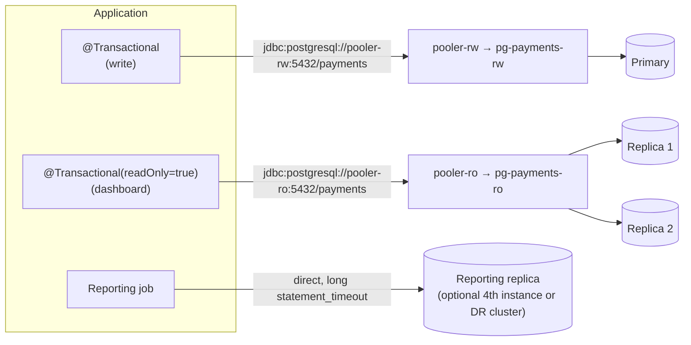

### 5.2 Java (Spring Boot): automatic read/write routing

```java
// 1) Route by transaction type
public class ReadWriteRoutingDataSource extends AbstractRoutingDataSource {
    @Override
    protected Object determineCurrentLookupKey() {
        return TransactionSynchronizationManager.isCurrentTransactionReadOnly() ? "ro" : "rw";
    }
}

// 2) Wire two Hikari pools; LazyConnectionDataSourceProxy delays picking a connection
//    until the @Transactional(readOnly=...) flag is known.
@Configuration
public class DataSourceConfig {

    @Bean @ConfigurationProperties("app.datasource.rw.hikari")
    public HikariDataSource rwDataSource() { return new HikariDataSource(); }

    @Bean @ConfigurationProperties("app.datasource.ro.hikari")
    public HikariDataSource roDataSource() { return new HikariDataSource(); }

    @Bean @Primary
    public DataSource dataSource(@Qualifier("rwDataSource") DataSource rw,
                                 @Qualifier("roDataSource") DataSource ro) {
        var routing = new ReadWriteRoutingDataSource();
        routing.setTargetDataSources(Map.of("rw", rw, "ro", ro));
        routing.setDefaultTargetDataSource(rw);
        routing.afterPropertiesSet();
        return new LazyConnectionDataSourceProxy(routing);
    }
}

// 3) Set the tenant at the start of EVERY transaction (works with PgBouncer transaction mode)
@Component
@RequiredArgsConstructor
public class TenantTx {
    private final JdbcTemplate jdbc;
    public void bind(UUID tenantId) {
        // set_config(..., is_local = true) == SET LOCAL, cleared on COMMIT/ROLLBACK
        jdbc.queryForObject("select set_config('app.tenant_id', ?, true)", String.class, tenantId.toString());
    }
}

@Service @RequiredArgsConstructor
public class PaymentQueryService {
    private final TenantTx tenantTx; private final JdbcTemplate jdbc;

    @Transactional(readOnly = true)              // → goes to replicas
    public List<Map<String,Object>> recent(UUID tenantId) {
        tenantTx.bind(tenantId);
        return jdbc.queryForList("""
            select txn_id, created_at, status, amount_minor, currency
              from pay.transactions
             where tenant_id = ? and created_at >= now() - interval '7 days'
             order by created_at desc limit 50""", tenantId);
    }
}
```

```yaml
# application.yml
app:
  datasource:
    rw:
      hikari:
        jdbc-url: jdbc:postgresql://pooler-payments-rw.payments-db.svc:5432/payments?sslmode=require&prepareThreshold=0
        username: api_user
        maximum-pool-size: 20        # per app pod; see Section 9 for the math
        minimum-idle: 5
        connection-timeout: 2000     # ms: fail fast rather than queue forever
        max-lifetime: 1800000
        keepalive-time: 300000
    ro:
      hikari:
        jdbc-url: jdbc:postgresql://pooler-payments-ro.payments-db.svc:5432/payments?sslmode=require&prepareThreshold=0
        username: api_reader
        maximum-pool-size: 20
        read-only: true
```

> `prepareThreshold=0` disables server-side prepared statements in the JDBC driver. That's the safest setting behind PgBouncer in transaction mode. With PgBouncer ≥ 1.21 you can enable `max_prepared_statements` instead and keep the driver default (Section 9.4).

### 5.3 Node.js: two pools plus a tenant helper

```javascript
// db.js
const { Pool } = require('pg');
const rw = new Pool({ host: 'pooler-payments-rw.payments-db.svc', database: 'payments',
                      user: 'api_user', password: process.env.PG_RW_PASS, max: 20,
                      connectionTimeoutMillis: 2000, idleTimeoutMillis: 30000, ssl: { rejectUnauthorized: true } });
const ro = new Pool({ host: 'pooler-payments-ro.payments-db.svc', database: 'payments',
                      user: 'api_reader', password: process.env.PG_RO_PASS, max: 20,
                      connectionTimeoutMillis: 2000, ssl: { rejectUnauthorized: true } });

async function withTenant(pool, tenantId, fn) {
  const client = await pool.connect();
  try {
    await client.query('BEGIN');
    await client.query("SELECT set_config('app.tenant_id', $1, true)", [tenantId]);
    const result = await fn(client);
    await client.query('COMMIT');
    return result;
  } catch (e) { await client.query('ROLLBACK'); throw e; }
  finally { client.release(); }
}
module.exports = { rw, ro, withTenant };
```

### 5.4 Python (psycopg 3)

```python
from psycopg_pool import ConnectionPool
rw = ConnectionPool("host=pooler-payments-rw.payments-db.svc dbname=payments user=api_user sslmode=require",
                    min_size=5, max_size=20, timeout=2, kwargs={"prepare_threshold": None})

def recent_txns(tenant_id: str):
    with rw.connection() as conn, conn.transaction():
        conn.execute("select set_config('app.tenant_id', %s, true)", (tenant_id,))
        return conn.execute("""select txn_id, status, amount_minor from pay.transactions
                               where tenant_id = %s order by created_at desc limit 50""",
                            (tenant_id,)).fetchall()
```

### 5.5 Handling replica lag safely

* **Read-after-write:** For N seconds after a tenant writes, route that tenant's reads to the primary (a "sticky primary" flag in the request context or a short-lived cache).
* **Bound staleness:** Reject a replica if its lag exceeds a threshold. The app or a health check can run `SELECT now() - pg_last_xact_replay_timestamp();` on the replica. The CNPG `-ro` service also only routes to instances that are ready.
* **Money decisions** (balance checks, refund eligibility) **always read from the primary.**

---

## 6. Hands-On Lab 1: Primary + Standby + Replica with Docker

**Goal:** Build streaming replication **by hand** so you understand what the Kubernetes operator automates. You'll create a primary, a synchronous standby and a read replica, then fail over, promote and rebuild, all on your laptop.

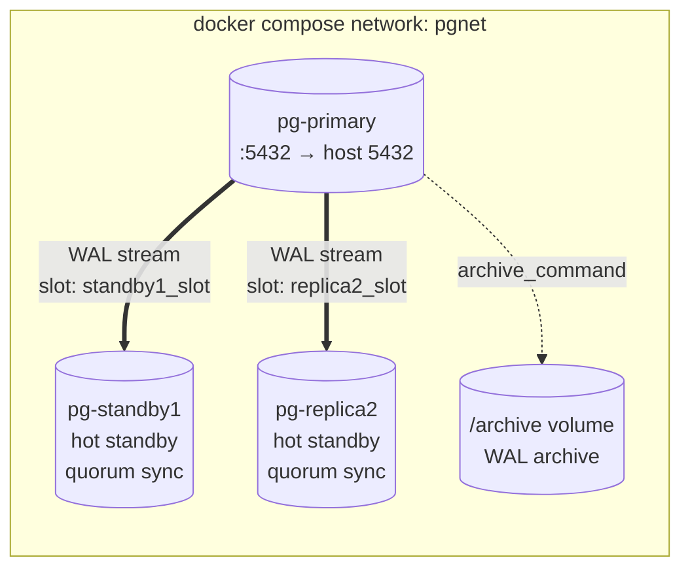

### 6.1 Create the project folder

```bash
$ mkdir -p ~/pg-ha-lab && cd ~/pg-ha-lab
```

### 6.2 `init-primary.sh`: runs once when the primary is first created

```bash
#!/bin/bash
# ~/pg-ha-lab/init-primary.sh
set -euo pipefail

psql -v ON_ERROR_STOP=1 --username "$POSTGRES_USER" --dbname "$POSTGRES_DB" <<-'EOSQL'
    -- A dedicated role that is only allowed to replicate
    CREATE ROLE replicator WITH REPLICATION LOGIN PASSWORD 'replpass';
    CREATE EXTENSION IF NOT EXISTS pg_stat_statements;
EOSQL

# Allow replication connections from the docker network
echo "host  replication  replicator  all  scram-sha-256" >> "$PGDATA/pg_hba.conf"
```

### 6.3 `standby-entrypoint.sh`: clones the primary, then starts as a standby

```bash
#!/bin/bash
# ~/pg-ha-lab/standby-entrypoint.sh
set -euo pipefail
: "${STANDBY_NAME:?set STANDBY_NAME}" "${PRIMARY_HOST:?set PRIMARY_HOST}"
export PGPASSWORD="${REPL_PASSWORD}"

if [ ! -s "$PGDATA/PG_VERSION" ]; then
  echo ">>> Empty data directory: cloning from ${PRIMARY_HOST}"
  until pg_isready -h "$PRIMARY_HOST" -U replicator -d postgres; do sleep 1; done

  mkdir -p "$PGDATA" && chown postgres:postgres "$PGDATA" && chmod 700 "$PGDATA"

  # -X stream : also copy WAL generated during the backup
  # -C -S     : Create a replication Slot on the primary for this standby
  gosu postgres pg_basebackup -h "$PRIMARY_HOST" -U replicator -D "$PGDATA" \
       -X stream -C -S "${STANDBY_NAME}_slot" -P -v

  # standby.signal = "start in standby mode and keep replaying WAL"
  gosu postgres touch "$PGDATA/standby.signal"
  gosu postgres bash -c "cat >> '$PGDATA/postgresql.auto.conf' <<EOF
primary_conninfo = 'host=${PRIMARY_HOST} port=5432 user=replicator password=${REPL_PASSWORD} application_name=${STANDBY_NAME}'
primary_slot_name = '${STANDBY_NAME}_slot'
EOF"
fi

exec gosu postgres postgres \
  -c hot_standby=on \
  -c hot_standby_feedback=on \
  -c max_standby_streaming_delay=30s \
  -c wal_level=replica -c max_wal_senders=10 -c max_replication_slots=10 \
  -c cluster_name="${STANDBY_NAME}"
```

```bash
$ chmod +x init-primary.sh standby-entrypoint.sh
```

### 6.4 `docker-compose.yml`

```yaml
# ~/pg-ha-lab/docker-compose.yml
name: pg-ha-lab

x-pg-image: &pgimage postgres:17     # pin an exact minor (e.g. 17.6) in real environments

services:
  pg-primary:
    image: *pgimage
    container_name: pg-primary
    hostname: pg-primary
    environment:
      POSTGRES_PASSWORD: superpass
      POSTGRES_DB: payments
      POSTGRES_INITDB_ARGS: "--data-checksums"     # detects silent disk corruption; needed by pg_rewind
    # Runs as root first so we can prepare /archive, then hands over to the normal entrypoint
    entrypoint: ["bash", "-c", "mkdir -p /archive && chown postgres:postgres /archive && exec docker-entrypoint.sh \"$$@\"", "--"]
    command:
      - postgres
      - -c
      - wal_level=replica
      - -c
      - max_wal_senders=10
      - -c
      - max_replication_slots=10
      - -c
      - max_slot_wal_keep_size=10GB          # a dead standby can't fill the disk forever
      - -c
      - synchronous_standby_names=ANY 1 (standby1, replica2)
      - -c
      - synchronous_commit=on
      - -c
      - archive_mode=on
      - -c
      - archive_command=test ! -f /archive/%f && cp %p /archive/%f
      - -c
      - shared_preload_libraries=pg_stat_statements
      - -c
      - wal_log_hints=on
      - -c
      - cluster_name=primary
    ports: ["5432:5432"]
    volumes:
      - primary-data:/var/lib/postgresql/data
      - wal-archive:/archive
      - ./init-primary.sh:/docker-entrypoint-initdb.d/01-init.sh:ro
    healthcheck:
      test: ["CMD-SHELL", "pg_isready -U postgres -d payments"]
      interval: 5s
      retries: 20
    networks: [pgnet]

  pg-standby1:
    image: *pgimage
    container_name: pg-standby1
    hostname: pg-standby1
    environment: { STANDBY_NAME: standby1, PRIMARY_HOST: pg-primary, REPL_PASSWORD: replpass }
    entrypoint: ["/standby-entrypoint.sh"]
    depends_on: { pg-primary: { condition: service_healthy } }
    ports: ["5433:5432"]
    volumes:
      - standby1-data:/var/lib/postgresql/data
      - ./standby-entrypoint.sh:/standby-entrypoint.sh:ro
    networks: [pgnet]

  pg-replica2:
    image: *pgimage
    container_name: pg-replica2
    hostname: pg-replica2
    environment: { STANDBY_NAME: replica2, PRIMARY_HOST: pg-primary, REPL_PASSWORD: replpass }
    entrypoint: ["/standby-entrypoint.sh"]
    depends_on: { pg-primary: { condition: service_healthy } }
    ports: ["5434:5432"]
    volumes:
      - replica2-data:/var/lib/postgresql/data
      - ./standby-entrypoint.sh:/standby-entrypoint.sh:ro
    networks: [pgnet]

volumes: { primary-data: {}, standby1-data: {}, replica2-data: {}, wal-archive: {} }
networks: { pgnet: {} }
```

> **Why `postgres:17` and not `postgres:18` for this lab?** The official 18 image moved its data directory to `/var/lib/postgresql/18/docker` (volume mounted at `/var/lib/postgresql`). The scripts above assume the classic `/var/lib/postgresql/data`. If you use 18, change the volume paths accordingly.

### 6.5 Start it and verify replication

```bash
$ docker compose up -d
$ docker compose logs -f pg-standby1      # watch it clone; Ctrl-C when you see "started streaming WAL"
```

🟢 **On the primary**: who is replicating, and how far behind?

```bash
$ docker exec -it pg-primary psql -U postgres -d payments
```

```sql
SELECT application_name, client_addr, state, sync_state,
       pg_size_pretty(pg_wal_lsn_diff(pg_current_wal_lsn(), sent_lsn))   AS send_lag,
       pg_size_pretty(pg_wal_lsn_diff(pg_current_wal_lsn(), replay_lsn)) AS replay_lag_bytes,
       write_lag, flush_lag, replay_lag
FROM pg_stat_replication;
```

Expected:

```
 application_name | state     | sync_state | send_lag | replay_lag_bytes | ...
------------------+-----------+------------+----------+------------------+
 standby1         | streaming | quorum     | 0 bytes  | 0 bytes          |
 replica2         | streaming | quorum     | 0 bytes  | 0 bytes          |
```

`sync_state = quorum` means "any 1 of these 2 must confirm each commit".

```sql
-- Replication slots: WAL retained for each standby
SELECT slot_name, active, wal_status,
       pg_size_pretty(pg_wal_lsn_diff(pg_current_wal_lsn(), restart_lsn)) AS retained_wal
FROM pg_replication_slots;

-- WAL archiving health
SELECT archived_count, last_archived_wal, last_archived_time, failed_count, last_failed_wal
FROM pg_stat_archiver;
```

🟢 **On the standby**:

```bash
$ docker exec -it pg-standby1 psql -U postgres -d payments
```

```sql
SELECT pg_is_in_recovery();                                  -- t  (it's a standby)
SELECT status, sender_host, slot_name, latest_end_lsn FROM pg_stat_wal_receiver;
SELECT now() - pg_last_xact_replay_timestamp() AS replay_delay;  -- time lag
```

### 6.6 Exercise: write on primary, read on standby

```bash
$ docker exec -it pg-primary psql -U postgres -d payments -c \
  "CREATE TABLE demo(id int primary key, note text); INSERT INTO demo VALUES (1,'hello from primary');"

$ docker exec -it pg-standby1 psql -U postgres -d payments -c "SELECT * FROM demo;"
#  id |        note
#   1 | hello from primary

$ docker exec -it pg-standby1 psql -U postgres -d payments -c "INSERT INTO demo VALUES (2,'x');"
# ERROR:  cannot execute INSERT in a read-only transaction   ← standbys are read-only
```

### 6.7 Exercise: see synchronous replication protect you

```bash
$ docker stop pg-standby1 pg-replica2          # no standby can acknowledge now
$ docker exec -it pg-primary psql -U postgres -d payments -c "INSERT INTO demo VALUES (3,'will it commit?');"
# ...hangs. The primary will NOT confirm a commit that exists on only one machine.
# Open another terminal and start one standby:
$ docker start pg-standby1                       # the INSERT now completes
$ docker start pg-replica2
```

**Lesson:** with 3 nodes and `ANY 1 (…)`, you can lose **one** standby without blocking. Lose both and writes pause rather than risk data loss. That is the right trade-off for payments. (CNPG lets you choose this behaviour with `dataDurability: required` versus `preferred`, as shown in Section 7.)

### 6.8 Exercise: failover (promote a standby)

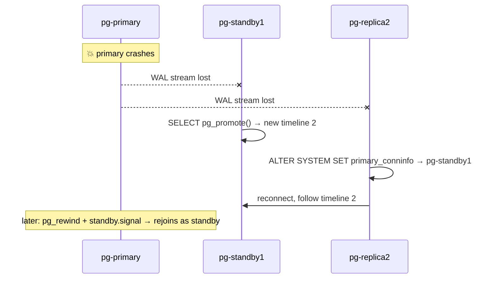

```bash
# 1. Simulate primary failure
$ docker stop pg-primary

# 2. Promote standby1 (on Kubernetes the operator does this for you)
$ docker exec -it pg-standby1 psql -U postgres -c "SELECT pg_promote(wait => true);"
$ docker exec -it pg-standby1 psql -U postgres -c "SELECT pg_is_in_recovery();"     # f → it's primary now

# 3. On the new primary: create a slot for replica2 and set sync standby names
$ docker exec -it pg-standby1 psql -U postgres -c "SELECT pg_create_physical_replication_slot('replica2_slot');"
$ docker exec -it pg-standby1 psql -U postgres -c "ALTER SYSTEM SET synchronous_standby_names = 'ANY 1 (replica2, primary)';"
$ docker exec -it pg-standby1 psql -U postgres -c "SELECT pg_reload_conf();"

# 4. Re-point replica2 at the new primary (primary_conninfo is reloadable since PG 13)
$ docker exec -it pg-replica2 psql -U postgres -c \
  "ALTER SYSTEM SET primary_conninfo = 'host=pg-standby1 port=5432 user=replicator password=replpass application_name=replica2';"
$ docker exec -it pg-replica2 psql -U postgres -c "SELECT pg_reload_conf();"
$ docker exec -it pg-replica2 psql -U postgres -c "SELECT status, sender_host FROM pg_stat_wal_receiver;"
# streaming | pg-standby1   (recovery_target_timeline='latest' makes it follow the new timeline)
```

> The new primary needs a `replicator` role and a `pg_hba.conf` rule for replication. Both came along in the base backup, which is why cloning is the right way to build standbys.

### 6.9 Exercise: rebuild the old primary as a standby with `pg_rewind`

The old primary may contain a few WAL records the new primary never received, so it has **diverged**. `pg_rewind` rolls back only the changed blocks. That's much faster than a full re-clone on a big database. It requires `wal_log_hints=on` or data checksums, and we enabled both.

```bash
# 🟡 The old primary must be stopped (it is). Rewind it against the new primary:
$ docker compose run --rm --no-deps --entrypoint bash pg-primary -c '
  gosu postgres pg_rewind --target-pgdata=/var/lib/postgresql/data \
     --source-server="host=pg-standby1 port=5432 user=postgres password=superpass dbname=postgres" \
     --progress &&
  gosu postgres touch /var/lib/postgresql/data/standby.signal &&
  gosu postgres bash -c "cat >> /var/lib/postgresql/data/postgresql.auto.conf <<EOF
primary_conninfo = '\''host=pg-standby1 port=5432 user=replicator password=replpass application_name=primary'\''
primary_slot_name = '\''primary_slot'\''
EOF"'

$ docker exec -it pg-standby1 psql -U postgres -c "SELECT pg_create_physical_replication_slot('primary_slot');"
$ docker start pg-primary
$ docker exec -it pg-primary psql -U postgres -c "SELECT pg_is_in_recovery();"   # t → it's a standby now
```

> 🔴 **Never just restart a failed primary without rewinding or re-cloning it.** It would come up as a second primary: **split-brain**. Preventing this automatically (fencing) is one of the biggest reasons to use an operator.

### 6.10 Bonus: a *delayed* standby (protects against human error)

A standby that applies WAL one hour late gives you an hour to recover from `DELETE FROM pay.transactions;` without a full PITR restore:

```sql
-- On a dedicated extra standby only (never on your failover candidates!)
ALTER SYSTEM SET recovery_min_apply_delay = '1h';
SELECT pg_reload_conf();
-- To rescue data: pause replay, copy the rows out, resume
SELECT pg_wal_replay_pause();   SELECT pg_wal_replay_resume();
```

### 6.11 Clean up

```bash
$ docker compose down -v      # 🔴 -v deletes all lab data volumes
```

### 6.12 Troubleshooting the lab

| Symptom | Cause | Fix |
|---|---|---|
| `replication slot "standby1_slot" already exists` | You wiped a standby volume but the slot remains on the primary | `SELECT pg_drop_replication_slot('standby1_slot');` on primary, then restart standby |
| `no pg_hba.conf entry for replication connection` | Missing hba line | Check `init-primary.sh` ran (only runs on an **empty** volume) |
| Standby log: `requested WAL segment ... has already been removed` | Standby was too far behind and the slot was invalidated (`max_slot_wal_keep_size`) | Re-clone the standby (wipe its volume) |
| Primary disk filling | Inactive slot holding WAL | Find it with the `pg_replication_slots` query and drop it if the standby is gone |

---

## 7. Production on Kubernetes with CloudNativePG

### 7.1 Why an operator, and why CloudNativePG?

Running a database in Kubernetes needs something that understands PostgreSQL roles (primary vs standby), not just pods. An **operator** is a controller that does what you did by hand in Section 6, continuously and safely.

| Option | How HA works | Notes |
|---|---|---|
| **CloudNativePG (CNPG)** ✅ | Operator manages instances directly, uses the K8s API for leader election, no external DCS | CNCF project, declarative, built-in PgBouncer `Pooler`, backups, replica clusters, `kubectl cnpg` plugin |
| Zalando postgres-operator | Patroni inside each pod | Mature, popular |
| Crunchy PGO | Patroni + pgBackRest | Mature, strong backup story |
| StackGres | Patroni + Envoy | Feature-rich UI |

All are valid. This guide uses **CNPG**.

### 7.2 Kubernetes prerequisites for production

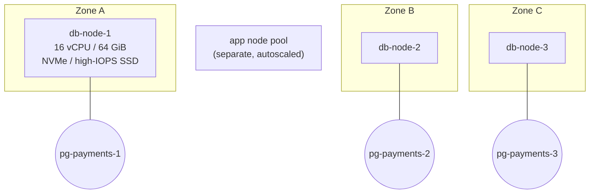

1. **A dedicated node pool for databases**, spread across 3 zones, labelled and tainted so only Postgres runs there.
2. **A fast `StorageClass`** (e.g. AWS `gp3`/`io2`, GCP `pd-ssd`/Hyperdisk, Azure Premium SSD v2, or local NVMe with a local-PV provisioner) with `volumeBindingMode: WaitForFirstConsumer` and `allowVolumeExpansion: true`.
3. **Object storage** (S3 / GCS / Azure Blob, or MinIO on-prem) for backups.
4. **cert-manager** (used by the backup plugin).
5. **Prometheus Operator** (for monitoring).

```bash
# 🟡 Label and taint the database nodes (names are examples)
$ kubectl label node db-node-1 db-node-2 db-node-3 workload=postgres
$ kubectl taint node db-node-1 db-node-2 db-node-3 workload=postgres:NoSchedule
$ kubectl get nodes -L topology.kubernetes.io/zone,workload
```

Example `StorageClass` (AWS EBS CSI driver):

```yaml
apiVersion: storage.k8s.io/v1
kind: StorageClass
metadata:
  name: pg-fast
provisioner: ebs.csi.aws.com
parameters:
  type: gp3
  iops: "12000"
  throughput: "500"
  fsType: xfs
  encrypted: "true"               # encryption at rest (PCI DSS)
volumeBindingMode: WaitForFirstConsumer
allowVolumeExpansion: true
reclaimPolicy: Retain             # never auto-delete a payments volume
```

#### Practising locally with `kind` (Kubernetes in Docker)

```yaml
# kind-3zones.yaml
kind: Cluster
apiVersion: kind.x-k8s.io/v1alpha4
nodes:
  - role: control-plane
  - role: worker
    labels: { topology.kubernetes.io/zone: zone-a, workload: postgres }
  - role: worker
    labels: { topology.kubernetes.io/zone: zone-b, workload: postgres }
  - role: worker
    labels: { topology.kubernetes.io/zone: zone-c, workload: postgres }
```

```bash
$ kind create cluster --name pg-lab --config kind-3zones.yaml
$ kubectl get nodes -L topology.kubernetes.io/zone
# kind ships a "standard" StorageClass (local-path); use storageClass: standard in the lab
```

### 7.3 Install the operator, plugin and backup plugin

```bash
# 1) cert-manager (needed by the Barman Cloud backup plugin)
$ helm repo add jetstack https://charts.jetstack.io && helm repo update
$ helm upgrade --install cert-manager jetstack/cert-manager \
    --namespace cert-manager --create-namespace --set crds.enabled=true

# 2) CloudNativePG operator
$ helm repo add cnpg https://cloudnative-pg.github.io/charts && helm repo update
$ helm upgrade --install cnpg cnpg/cloudnative-pg \
    --namespace cnpg-system --create-namespace
$ kubectl -n cnpg-system rollout status deployment/cnpg-cloudnative-pg

# 3) kubectl plugin (status, promote, backup, psql, fencing, ...)
$ kubectl krew install cnpg          # or see the CNPG docs for the curl installer
$ kubectl cnpg version

# 4) Barman Cloud plugin: backups/WAL archiving to object storage.
#    Check https://github.com/cloudnative-pg/plugin-barman-cloud/releases for the latest version.
$ BARMAN_PLUGIN_VERSION=vX.Y.Z
$ kubectl apply -f https://github.com/cloudnative-pg/plugin-barman-cloud/releases/download/${BARMAN_PLUGIN_VERSION}/manifest.yaml
$ kubectl -n cnpg-system rollout status deployment/barman-cloud
```

> **Older CNPG versions** (before the plugin architecture) configured backups in-tree with `spec.backup.barmanObjectStore`. That still exists but is deprecated in favour of the plugin. If you inherit an older cluster you'll see that form.

### 7.4 Build a custom image with the extensions we need

The standard CNPG images include common extensions. We also want **pg_partman** (partition automation) and **pg_cron** (in-database scheduler). The images are Debian-based with the PGDG apt repository, so:

```dockerfile
# Dockerfile.postgres
ARG PG_TAG=17                       # pin e.g. 17.6-bookworm in production; check ghcr.io tags
FROM ghcr.io/cloudnative-pg/postgresql:${PG_TAG}
USER root
RUN apt-get update \
 && apt-get install -y --no-install-recommends postgresql-17-partman postgresql-17-cron \
 && rm -rf /var/lib/apt/lists/*
USER 26                             # CNPG images run as uid 26 (postgres)
```

```bash
$ docker build -f Dockerfile.postgres -t registry.example.com/db/postgresql-payments:17-1 .
$ docker push registry.example.com/db/postgresql-payments:17-1
# For kind:  kind load docker-image registry.example.com/db/postgresql-payments:17-1 --name pg-lab
```

### 7.5 Namespace and secrets

```bash
$ kubectl create namespace payments-db

# App owner (used by bootstrap) and login roles (managed below)
$ kubectl -n payments-db create secret generic pg-payments-owner \
    --type=kubernetes.io/basic-auth --from-literal=username=payments_owner --from-literal=password="$(openssl rand -base64 24)"
$ for u in migrator api_user api_reader bi_user; do
    kubectl -n payments-db create secret generic pg-role-$u --type=kubernetes.io/basic-auth \
      --from-literal=username=$u --from-literal=password="$(openssl rand -base64 24)"
  done

# Object storage credentials (use IRSA / Workload Identity instead of keys where you can)
$ kubectl -n payments-db create secret generic pg-backup-s3 \
    --from-literal=ACCESS_KEY_ID=AKIA... --from-literal=ACCESS_SECRET_KEY=...
```

> In real production, manage secrets with **External Secrets Operator + Vault/AWS Secrets Manager** or **Sealed Secrets**, never plain YAML in Git.

### 7.6 Backup destination (`ObjectStore`)

```yaml
# 10-objectstore.yaml
apiVersion: barmancloud.cnpg.io/v1
kind: ObjectStore
metadata:
  name: pg-payments-store
  namespace: payments-db
spec:
  retentionPolicy: "30d"                  # keep enough backups + WAL for 30 days of PITR
  configuration:
    destinationPath: s3://acme-pg-backups/payments/
    # endpointURL: http://minio.minio.svc:9000   # for MinIO / on-prem S3
    s3Credentials:
      accessKeyId:     { name: pg-backup-s3, key: ACCESS_KEY_ID }
      secretAccessKey: { name: pg-backup-s3, key: ACCESS_SECRET_KEY }
    wal:
      compression: gzip
      maxParallel: 4                       # archive WAL faster under heavy write load
    data:
      compression: gzip
      jobs: 4
```

### 7.7 The production `Cluster` manifest (annotated)

```yaml
# 20-cluster.yaml
apiVersion: postgresql.cnpg.io/v1
kind: Cluster
metadata:
  name: pg-payments
  namespace: payments-db
spec:
  description: "Payments OLTP: pooled tenants, shard 01"
  instances: 3                               # 1 primary + 2 hot standbys
  imageName: registry.example.com/db/postgresql-payments:17-1

  # --- Rolling updates: replace standbys first, then switch over (not restart) the primary
  primaryUpdateStrategy: unsupervised         # set "supervised" if a human must approve the switchover
  primaryUpdateMethod: switchover

  # --- How long to wait before declaring the primary dead / for a clean shutdown
  failoverDelay: 0
  switchoverDelay: 60
  stopDelay: 120
  smartShutdownTimeout: 30

  postgresql:
    # Quorum synchronous replication: commit is ACKed by ≥1 standby
    synchronous:
      method: any
      number: 1
      dataDurability: required               # block writes rather than lose data ("preferred" = degrade to async)

    shared_preload_libraries:
      - pg_cron
    parameters:                               # full explanation in Section 13
      # Memory (pod limit = 64Gi)
      shared_buffers: "16GB"
      effective_cache_size: "44GB"
      work_mem: "32MB"
      maintenance_work_mem: "2GB"
      autovacuum_work_mem: "1GB"
      huge_pages: "try"
      # Connections (PgBouncer in front, so keep this modest)
      max_connections: "400"
      superuser_reserved_connections: "5"
      idle_in_transaction_session_timeout: "60s"
      # WAL & checkpoints
      wal_compression: "lz4"
      wal_buffers: "64MB"
      max_wal_size: "16GB"
      min_wal_size: "4GB"
      checkpoint_timeout: "15min"
      checkpoint_completion_target: "0.9"
      max_slot_wal_keep_size: "50GB"
      archive_timeout: "60s"                  # force a WAL segment switch at least every minute (bounds DR/PITR lag)
      # Planner / IO (SSD)
      random_page_cost: "1.1"
      effective_io_concurrency: "200"
      default_statistics_target: "200"
      jit: "off"
      # Parallelism (16 vCPU)
      max_worker_processes: "24"
      max_parallel_workers: "12"
      max_parallel_workers_per_gather: "4"
      max_parallel_maintenance_workers: "4"
      # Autovacuum: aggressive, because payments tables churn
      autovacuum_max_workers: "6"
      autovacuum_naptime: "15s"
      autovacuum_vacuum_scale_factor: "0.05"
      autovacuum_analyze_scale_factor: "0.02"
      autovacuum_vacuum_cost_limit: "2000"
      autovacuum_vacuum_insert_scale_factor: "0.05"
      # Standbys
      hot_standby_feedback: "on"
      max_standby_streaming_delay: "30s"
      # Observability
      track_io_timing: "on"
      track_wal_io_timing: "on"
      log_min_duration_statement: "250ms"
      log_lock_waits: "on"
      log_autovacuum_min_duration: "1s"
      log_checkpoints: "on"
      log_temp_files: "0"
      pg_stat_statements.max: "10000"
      pg_stat_statements.track: "all"
      # pg_cron
      cron.database_name: "payments"
    pg_hba:
      - hostssl payments all 10.0.0.0/8 scram-sha-256    # tighten to your pod CIDR

  bootstrap:
    initdb:
      database: payments
      owner: payments_owner
      secret: { name: pg-payments-owner }
      dataChecksums: true                     # detect silent corruption
      encoding: UTF8
      localeCollate: C                        # deterministic, fast sorting for IDs/refs
      localeCType: C
      postInitApplicationSQL:                 # runs in "payments" as superuser
        - CREATE EXTENSION IF NOT EXISTS pg_cron   # must live in cron.database_name
        - CREATE EXTENSION IF NOT EXISTS pg_stat_statements
        - CREATE SCHEMA IF NOT EXISTS partman
        - CREATE EXTENSION IF NOT EXISTS pg_partman SCHEMA partman

  # Declarative roles: CNPG creates/updates these and their passwords from Secrets
  managed:
    roles:
      - { name: app_rw, ensure: present, login: false, bypassrls: false }
      - { name: app_ro, ensure: present, login: false, bypassrls: false }
      - { name: platform_reporting, ensure: present, login: false, bypassrls: true }
      - name: migrator
        ensure: present
        login: true
        inRoles: [payments_owner]
        passwordSecret: { name: pg-role-migrator }
      - name: api_user
        ensure: present
        login: true
        connectionLimit: 300
        inRoles: [app_rw]
        passwordSecret: { name: pg-role-api_user }
      - name: api_reader
        ensure: present
        login: true
        connectionLimit: 300
        inRoles: [app_ro]
        passwordSecret: { name: pg-role-api_reader }
      - name: bi_user
        ensure: present
        login: true
        connectionLimit: 20
        inRoles: [platform_reporting]
        passwordSecret: { name: pg-role-bi_user }

  # --- Storage: separate volumes for data and WAL (WAL gets steady, sequential IO)
  storage:
    storageClass: pg-fast
    size: 1Ti
  walStorage:
    storageClass: pg-fast
    size: 200Gi

  # --- Guaranteed QoS: requests == limits (no CPU throttling surprises, no eviction)
  resources:
    requests: { cpu: "14", memory: "64Gi" }
    limits:   { cpu: "14", memory: "64Gi" }

  # --- Spread across zones, only on database nodes
  affinity:
    enablePodAntiAffinity: true
    podAntiAffinityType: required             # never 2 instances in the same zone
    topologyKey: topology.kubernetes.io/zone
    nodeSelector:
      workload: postgres
    tolerations:
      - { key: workload, operator: Equal, value: postgres, effect: NoSchedule }

  # --- Replication slots for HA standbys are managed by the operator
  replicationSlots:
    highAvailability:
      enabled: true
    updateInterval: 30

  # --- Continuous WAL archiving through the Barman Cloud plugin
  plugins:
    - name: barman-cloud.cloudnative-pg.io
      isWALArchiver: true
      parameters:
        barmanObjectName: pg-payments-store

  # --- Certificates: CNPG creates a CA and server certs; clients should use sslmode=verify-full
  # certificates: {...}   # plug in cert-manager-issued certs if your PKI requires it

  enableSuperuserAccess: false                # no remote superuser logins
```

```bash
$ kubectl apply -f 10-objectstore.yaml -f 20-cluster.yaml
$ kubectl -n payments-db get pods -w                   # pg-payments-1 (initdb), then -2, -3 join
$ kubectl cnpg status pg-payments -n payments-db       # the single most useful command
```

Sample `kubectl cnpg status` (abridged):

```
Cluster Summary
Name:                pg-payments
Primary instance:    pg-payments-1
Status:              Cluster in healthy state
Instances:           3
Ready instances:     3

Continuous Backup status
First Point of Recoverability:  2026-10-20T02:00:11Z
Working WAL archiving:          OK

Streaming Replication status
Name           Sent LSN    Write LSN   Flush LSN   Replay LSN  Write Lag  Flush Lag  Replay Lag  State      Sync State
pg-payments-2  1/A3000148  1/A3000148  1/A3000148  1/A3000148  00:00:00   00:00:00   00:00:00    streaming  quorum
pg-payments-3  1/A3000148  1/A3000148  1/A3000148  1/A3000148  00:00:00   00:00:00   00:00:00    streaming  quorum

Instances status
Name           Database Size  Current LSN  Replication role  Status  QoS         Node
pg-payments-1  2.1 GB         1/A3000148   Primary           OK      Guaranteed  db-node-1
pg-payments-2  2.1 GB         1/A3000148   Standby (sync)    OK      Guaranteed  db-node-2
pg-payments-3  2.1 GB         1/A3000148   Standby (sync)    OK      Guaranteed  db-node-3
```

### 7.8 Services CNPG creates for you

| Service | Points to | Use for |
|---|---|---|
| `pg-payments-rw` | Current primary only | Writes (behind `pooler-rw`) |
| `pg-payments-ro` | Hot standbys only | Read-only traffic (behind `pooler-ro`) |
| `pg-payments-r` | Any instance | Rarely needed |

After a failover, CNPG re-labels pods and the `-rw` Service follows the new primary automatically. **Applications never need to know which pod is primary.**

```bash
# Connect as yourself for admin work (exec into the primary)
$ kubectl cnpg psql pg-payments -n payments-db -- -d payments
```

### 7.9 Load the schema (migrations)

Run the SQL from Section 4 as the `migrator` role. In production use a migration tool (Flyway or Liquibase for Java, `node-pg-migrate` for Node, Alembic for Python) as a Kubernetes `Job` or CI step that connects to `pg-payments-rw` **directly** (not through the pooler), because migrations can need session features:

```yaml
# 30-migrate-job.yaml (Flyway example)
apiVersion: batch/v1
kind: Job
metadata: { name: payments-migrate-v42, namespace: payments-db }
spec:
  backoffLimit: 0
  template:
    spec:
      restartPolicy: Never
      containers:
        - name: flyway
          image: flyway/flyway:11          # pin the exact version you test with
          args: ["-url=jdbc:postgresql://pg-payments-rw:5432/payments?sslmode=require",
                 "-user=$(PGUSER)", "-password=$(PGPASSWORD)", "-connectRetries=10", "migrate"]
          env:
            - { name: PGUSER,     valueFrom: { secretKeyRef: { name: pg-role-migrator, key: username } } }
            - { name: PGPASSWORD, valueFrom: { secretKeyRef: { name: pg-role-migrator, key: password } } }
          volumeMounts: [{ name: sql, mountPath: /flyway/sql }]
      volumes: [{ name: sql, configMap: { name: payments-migrations } }]
```

### 7.10 Network policy: only the poolers and migrations may connect

```yaml
apiVersion: networking.k8s.io/v1
kind: NetworkPolicy
metadata: { name: pg-payments-ingress, namespace: payments-db }
spec:
  podSelector:
    matchLabels: { cnpg.io/cluster: pg-payments }
  policyTypes: [Ingress]
  ingress:
    - from:   # the other instances (replication) and the operator
        - podSelector: { matchLabels: { cnpg.io/cluster: pg-payments } }
        - namespaceSelector: { matchLabels: { kubernetes.io/metadata.name: cnpg-system } }
    - from:   # poolers and migration jobs in this namespace
        - podSelector: { matchExpressions: [{ key: cnpg.io/poolerName, operator: Exists }] }
        - podSelector: { matchLabels: { job-name: payments-migrate-v42 } }
      ports: [{ port: 5432 }]
    - from:   # Prometheus scraping metrics
        - namespaceSelector: { matchLabels: { kubernetes.io/metadata.name: monitoring } }
      ports: [{ port: 9187 }]
```

> CNPG automatically creates a **PodDisruptionBudget**, so `kubectl drain` can't take down the primary and a standby at the same time.

---

## 8. Creating and Maintaining Standbys and Replicas

On Kubernetes **every non-primary instance is a hot standby**: a failover candidate *and* a read replica. Here is everything you'll do with them in day-to-day operations.

### 8.1 Health and lag checks (daily)

```bash
$ kubectl cnpg status pg-payments -n payments-db          # replication table + backups
$ kubectl cnpg status pg-payments -n payments-db --verbose # adds config and slot details
```

```sql
-- On the primary (kubectl cnpg psql pg-payments -n payments-db -- -d payments)
SELECT application_name, sync_state, state,
       pg_size_pretty(pg_wal_lsn_diff(pg_current_wal_lsn(), replay_lsn)) AS lag_bytes,
       replay_lag
FROM pg_stat_replication ORDER BY application_name;
```

**Alert thresholds that work well for payments:** replay lag > **10 s** (warning) / > **60 s** (critical); `sync_state` not `quorum`/`sync` for > 2 min; any inactive replication slot retaining > **10 GB**.

### 8.2 Add or remove replicas (scale out reads)

```bash
# 🟡 Add a 4th instance: CNPG clones it from a backup or with pg_basebackup, then it streams
$ kubectl -n payments-db patch cluster pg-payments --type merge -p '{"spec":{"instances":4}}'
$ kubectl -n payments-db get pods -l cnpg.io/cluster=pg-payments -w

# Scale back down (CNPG removes the highest-numbered standby; it never removes the primary)
$ kubectl -n payments-db patch cluster pg-payments --type merge -p '{"spec":{"instances":3}}'
```

> With `podAntiAffinityType: required` and only 3 zones, a 4th instance can't schedule. Use `preferred`, or add more database nodes per zone, if you want more than one instance per zone.

### 8.3 Planned switchover (patching, node maintenance)

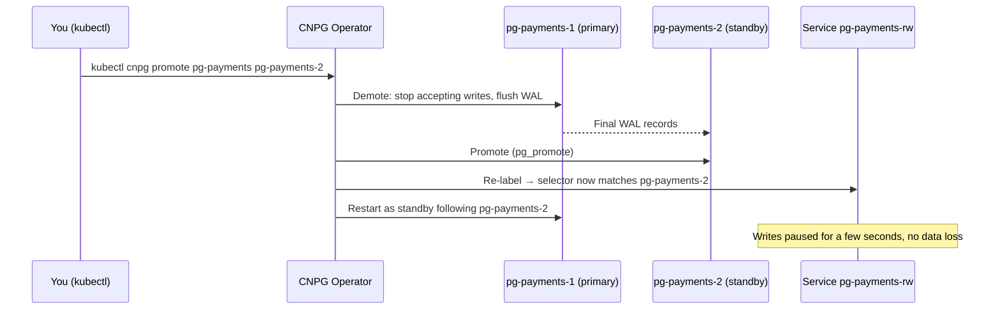

```bash
$ kubectl cnpg promote pg-payments pg-payments-2 -n payments-db
$ kubectl cnpg status pg-payments -n payments-db
```

PgBouncer keeps client connections open during the switch. Clients see a short pause, plus an error for any transaction that was in flight. **Make your app retry** idempotent operations (which the `idempotency_keys` table makes safe).

### 8.4 Failover drill (do this monthly in staging, quarterly in production)

```bash
# 🔴 Simulate primary loss
$ PRIMARY=$(kubectl -n payments-db get cluster pg-payments -o jsonpath='{.status.currentPrimary}')
$ kubectl -n payments-db delete pod "$PRIMARY" --grace-period=0 --force
$ watch -n 2 kubectl cnpg status pg-payments -n payments-db     # watch a standby get promoted
```

Measure: time until `pg-payments-rw` accepts writes (RTO) and confirm zero lost committed transactions (RPO), for example by comparing a continuously incrementing counter written by a test client.

### 8.5 Rebuild a broken or corrupted replica

```bash
# 🟡 Removes the instance AND its PVC, then CNPG creates a fresh clone
$ kubectl cnpg destroy pg-payments 3 -n payments-db
```

### 8.6 Fencing: freeze an instance for investigation

```bash
$ kubectl cnpg fencing on  pg-payments pg-payments-3 -n payments-db   # Postgres stopped, pod kept
$ kubectl cnpg fencing off pg-payments pg-payments-3 -n payments-db
```

Fencing the **primary** stops writes (no automatic failover happens while fenced). Use it during a suspected corruption or security incident.

### 8.7 Node maintenance (drain)

```bash
$ kubectl cordon db-node-2
$ kubectl drain db-node-2 --ignore-daemonsets --delete-emptydir-data
# If db-node-2 hosted the primary, CNPG switches over first (respecting the PDB).
# With network storage the PVC re-attaches on another node in the same zone.
# With LOCAL storage the instance must be re-cloned elsewhere.
$ kubectl uncordon db-node-2
```

### 8.8 Replication slots: the #1 cause of "disk full" incidents

```sql
SELECT slot_name, slot_type, active, wal_status, safe_wal_size,
       pg_size_pretty(pg_wal_lsn_diff(pg_current_wal_lsn(), restart_lsn)) AS retained
FROM pg_replication_slots ORDER BY restart_lsn;
```

* CNPG manages slots for its own standbys (`replicationSlots.highAvailability`).
* **Logical replication / CDC slots** (Debezium, for example) are yours to manage. A stopped Debezium connector will keep WAL forever unless `max_slot_wal_keep_size` caps it.
* `wal_status = 'lost'` means the slot's consumer must be re-initialised. Drop the slot: `SELECT pg_drop_replication_slot('name');`

### 8.9 Cross-region standby: the DR **replica cluster**

A **replica cluster** is a whole CNPG cluster in another region that stays in continuous recovery. Its primary is a "designated primary" that is itself a standby. It can be fed from the WAL archive in object storage, by streaming, or both.

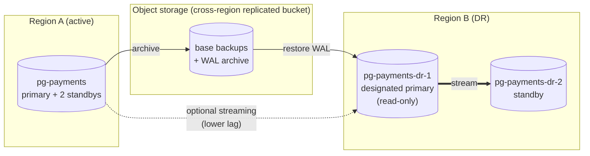

```yaml
# region-b/20-replica-cluster.yaml  (applied in the DR Kubernetes cluster)
apiVersion: postgresql.cnpg.io/v1
kind: Cluster
metadata: { name: pg-payments-dr, namespace: payments-db }
spec:
  instances: 2
  imageName: registry.example.com/db/postgresql-payments:17-1
  storage: { storageClass: pg-fast, size: 1Ti }
  walStorage: { storageClass: pg-fast, size: 200Gi }

  bootstrap:
    recovery:
      source: pg-payments-origin          # first sync = restore latest base backup

  replica:
    enabled: true                          # stay in continuous recovery
    source: pg-payments-origin

  externalClusters:
    - name: pg-payments-origin
      plugin:
        name: barman-cloud.cloudnative-pg.io
        parameters:
          barmanObjectName: pg-payments-store-region-a   # ObjectStore pointing at Region A's bucket
          serverName: pg-payments
```

**Promoting the DR cluster** (Region A is gone):

```bash
# 🔴 Make Region B the new primary site
$ kubectl -n payments-db patch cluster pg-payments-dr --type merge -p '{"spec":{"replica":{"enabled":false}}}'
# Then point the app's database DNS / config at Region B's poolers.
```

> Newer CNPG releases add a "distributed topology" with `replica.primary` and promotion tokens for a **controlled** (zero-data-loss) region switchover with demotion of the old site. Read the "Replica clusters" page of the docs for the version you run before your first DR drill.

> **DR replica RPO:** archive-only replication is as fresh as the last archived WAL segment (seconds to a minute; force a switch at least every 60 s with `archive_timeout = 60s`). Adding streaming brings it to sub-second, but it is **asynchronous**, so a region loss can lose the last moments of data. That's the industry-standard trade-off for cross-region.

---

## 9. Connection Pooling Step by Step

### 9.1 Why pooling is not optional

Every PostgreSQL connection is a **separate OS process**. It uses memory (a few MB at idle, much more while running with `work_mem`) and adds CPU scheduling overhead. A typical Kubernetes deployment multiplies connections quickly:

```
40 API pods  × 20 (Hikari max) = 800
10 worker pods × 10            = 100
                     total     = 900 connections  ← far too many for one PostgreSQL primary
```

But how many queries are **actually running at the same moment**? Use Little's Law:

```
concurrent queries = throughput × average duration
                   = 5,000 transactions/s × 0.004 s (4 ms)
                   = 20 busy connections
```

So 900 client connections need only about **20–60 real server connections**. PgBouncer is the multiplexer in between.

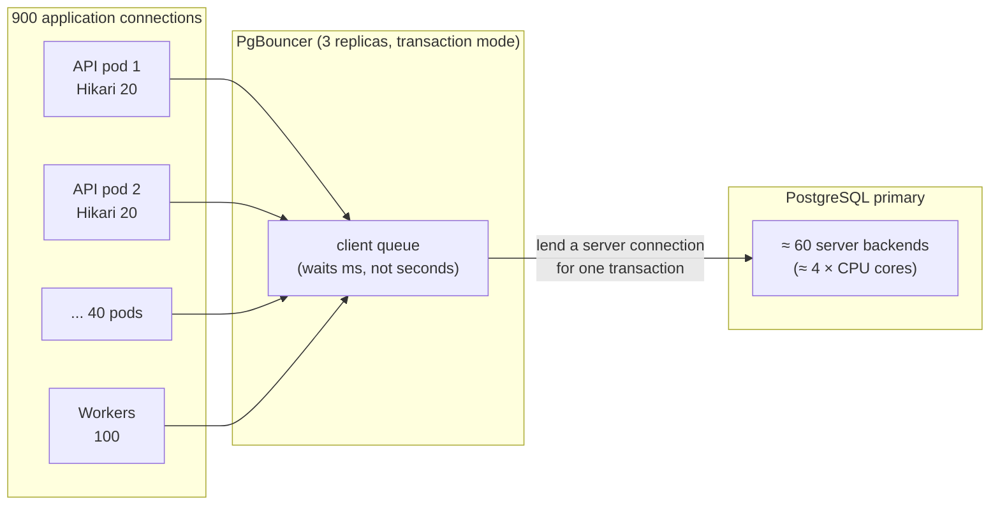

### 9.2 Pool modes and what breaks in each

| Mode | A server connection is returned to the pool after… | Use for | Breaks |
|---|---|---|---|
| `session` | the client disconnects | Migrations, admin tools | Nothing, but gives almost no multiplexing |
| **`transaction`** ✅ | each `COMMIT`/`ROLLBACK` | **All OLTP API traffic** | Session-level `SET` (use `SET LOCAL`), session advisory locks (use `pg_advisory_xact_lock`), `LISTEN/NOTIFY`, `WITH HOLD` cursors, temp tables across transactions, protocol-level prepared statements on PgBouncer < 1.21 |
| `statement` | each statement | Rare | Multi-statement transactions |

This is why the guide sets the tenant with `set_config('app.tenant_id', …, true)` (transaction-local) and not with a plain `SET`.

### 9.3 Sizing the server-side pool

A good starting point for an SSD-backed OLTP primary:

```
max active server connections  ≈  2–4 × vCPU   →  14 vCPU ⇒ 30–60
```

Then validate with load tests. If `cl_waiting` (clients waiting for a server connection) rises while CPU is **below** 70%, increase the pool. If CPU is pegged, a bigger pool only adds contention.

Our budget for the `pg-payments` primary (`max_connections = 400`):

| Consumer | Pooler instances | `max_db_connections` each | Server connections |
|---|---|---|---|
| `pooler-payments-rw` (API + workers) | 3 | 50 | 150 |
| Migrations / admin (direct) | — | — | 20 |
| CNPG internals, replication, monitoring | — | — | ~20 |
| `superuser_reserved_connections` | — | — | 5 |
| **Headroom** | | | ~200 |

Replicas get their own budget through `pooler-payments-ro`.

### 9.4 Deploy PgBouncer with the CNPG `Pooler` resource

CNPG wires authentication for you: the pooler looks up passwords with an `auth_query`, so you don't maintain a `userlist.txt`.

```yaml
# 40-pooler-rw.yaml
apiVersion: postgresql.cnpg.io/v1
kind: Pooler
metadata:
  name: pooler-payments-rw
  namespace: payments-db
spec:
  cluster: { name: pg-payments }
  instances: 3
  type: rw                                   # follows the primary through failovers
  pgbouncer:
    poolMode: transaction
    parameters:
      max_client_conn: "5000"                # client sockets are cheap
      default_pool_size: "40"                # per (database, user) pair, per pooler pod
      min_pool_size: "10"                    # keep warm connections ready for spikes
      reserve_pool_size: "10"                # extra when clients wait > reserve_pool_timeout
      reserve_pool_timeout: "1"
      max_db_connections: "50"               # hard cap per pooler pod toward the database
      server_idle_timeout: "300"
      server_lifetime: "3600"                # recycle server connections hourly
      query_wait_timeout: "10"               # fail a client that waited 10 s instead of hanging forever
      idle_transaction_timeout: "30"
      max_prepared_statements: "200"         # PgBouncer ≥ 1.21: prepared statements work in transaction mode
  template:
    metadata:
      labels: { app: pooler-payments-rw }
    spec:
      affinity:
        podAntiAffinity:
          preferredDuringSchedulingIgnoredDuringExecution:
            - weight: 100
              podAffinityTerm:
                topologyKey: topology.kubernetes.io/zone
                labelSelector: { matchLabels: { app: pooler-payments-rw } }
      containers:
        - name: pgbouncer
          resources:
            requests: { cpu: "1", memory: "256Mi" }
            limits:   { cpu: "2", memory: "512Mi" }
---
# 41-pooler-ro.yaml
apiVersion: postgresql.cnpg.io/v1
kind: Pooler
metadata:
  name: pooler-payments-ro
  namespace: payments-db
spec:
  cluster: { name: pg-payments }
  instances: 3
  type: ro                                   # load-balances across hot standbys
  pgbouncer:
    poolMode: transaction
    parameters:
      max_client_conn: "5000"
      default_pool_size: "40"
      max_db_connections: "60"
      query_wait_timeout: "10"
      max_prepared_statements: "200"
```

```bash
$ kubectl apply -f 40-pooler-rw.yaml -f 41-pooler-ro.yaml
$ kubectl -n payments-db get pooler,svc,deploy | grep pooler
# Apps connect to:  pooler-payments-rw.payments-db.svc:5432  and  pooler-payments-ro.payments-db.svc:5432
```

> **One PgBouncer pool per (database, user).** Giving the API (`api_user`), background workers (`worker_user`) and reporting (`bi_user`) **different users** gives each workload its own pool, so a slow batch job can't starve payment authorisations. Cap a heavy user with `max_user_connections` in the pooler, or `connectionLimit` on the role.

### 9.5 Watching the pool

Each pooler pod exposes Prometheus metrics on port **9127**:

```bash
$ kubectl -n payments-db port-forward deploy/pooler-payments-rw 9127:9127 &
$ curl -s localhost:9127/metrics | grep -E 'cnpg_pgbouncer_pools_(cl_active|cl_waiting|sv_active|sv_idle|maxwait)'
```

| Metric | Healthy | Investigate when |
|---|---|---|
| `cl_waiting` | 0 most of the time | > 0 for more than a few seconds |
| `maxwait` (seconds) | 0 | > 0.1 s: clients are queueing, so check slow queries first, then pool size |
| `sv_active` vs `max_db_connections` | well below cap | at cap: saturated |
| `sv_idle` | a few | 0 under load: pool too small *or* queries too slow |

The same numbers come from the PgBouncer admin console with `SHOW POOLS;`, `SHOW STATS;`, `SHOW CLIENTS;` and `SHOW SERVERS;`.

### 9.6 Standalone PgBouncer (VMs or the Docker lab)

```ini
; pgbouncer.ini
[databases]
payments    = host=pg-primary  port=5432 dbname=payments
payments_ro = host=pg-replica2 port=5432 dbname=payments

[pgbouncer]
listen_addr = 0.0.0.0
listen_port = 6432
auth_type = scram-sha-256
auth_user = pgbouncer_auth                       ; looks up other users' passwords via auth_query
auth_query = SELECT usename, passwd FROM pgbouncer.get_auth($1)
pool_mode = transaction
max_client_conn = 5000
default_pool_size = 40
min_pool_size = 10
reserve_pool_size = 10
reserve_pool_timeout = 1
max_db_connections = 60
server_idle_timeout = 300
query_wait_timeout = 10
max_prepared_statements = 200
admin_users = pgbouncer_admin
stats_users = pgbouncer_stats
server_tls_sslmode = require
```

```sql
-- On PostgreSQL: a SECURITY DEFINER function so the auth_user never needs superuser
CREATE ROLE pgbouncer_auth LOGIN PASSWORD 'change-me';
CREATE SCHEMA pgbouncer AUTHORIZATION postgres;
CREATE OR REPLACE FUNCTION pgbouncer.get_auth(p_usename text)
RETURNS TABLE(usename name, passwd text) LANGUAGE sql SECURITY DEFINER SET search_path = pg_catalog AS
$$ SELECT usename, passwd FROM pg_shadow WHERE usename = p_usename $$;
REVOKE ALL ON FUNCTION pgbouncer.get_auth(text) FROM PUBLIC;
GRANT USAGE ON SCHEMA pgbouncer TO pgbouncer_auth;
GRANT EXECUTE ON FUNCTION pgbouncer.get_auth(text) TO pgbouncer_auth;
```

```bash
$ psql -h localhost -p 6432 -U pgbouncer_admin pgbouncer -c "SHOW POOLS;"
$ psql -h localhost -p 6432 -U pgbouncer_admin pgbouncer -c "RELOAD;"     # apply ini changes without dropping clients
```

### 9.7 Application-side pool rules

1. **Keep app pools small** (10–20 per pod). PgBouncer does the heavy multiplexing, and huge app pools only hide problems.
2. **Fail fast:** `connectionTimeout` ≈ 2 s (Hikari), `connectionTimeoutMillis` (node-postgres), `timeout` (psycopg_pool).
3. **Short transactions:** no HTTP calls, sleeps or user think-time inside a transaction.
4. **Set `statement_timeout` and `idle_in_transaction_session_timeout`** on the role (Section 4.3), so one bad query can't hold a pooled connection for minutes.
5. **Retry on failover errors** (SQLSTATE `08006`, `08003`, `57P01`, `40001`) with backoff, **only for idempotent operations**.

---

## 10. Partitioning Step by Step

### 10.1 What partitioning gives you

A partitioned table is one logical table made of many physical child tables. For payments, partition **by time**:

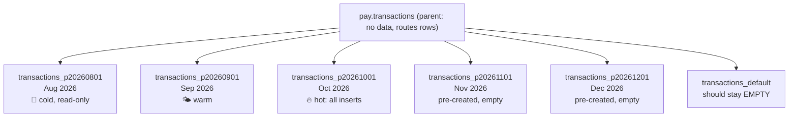

| Benefit | How |
|---|---|
| **Faster queries** | *Partition pruning*: `WHERE created_at >= '2026-10-01'` touches only October |
| **Hot data stays in RAM** | This month's indexes are small and stay cached |
| **Cheap retention** | `DETACH` / `DROP` a month in milliseconds, instead of a `DELETE` of 100 M rows that generates massive WAL and bloat |
| **Faster vacuum** | Autovacuum works per partition; old partitions are frozen once and then left alone |
| **Easier archiving** | Dump one partition to cold storage |

**When to partition:** tables expected to exceed roughly **50–100 GB**, or ~100 M rows, *and* whose queries naturally filter on the partition key. Don't partition small tables.

### 10.2 Choosing the strategy

| Strategy | Example | Good for |
|---|---|---|
| **RANGE** on time ✅ | `PARTITION BY RANGE (created_at)` monthly | Transactions, events, ledger, audit |
| LIST | `PARTITION BY LIST (region)` | A few discrete values, or a dedicated partition for a giant tenant |
| HASH | `PARTITION BY HASH (tenant_id)` with modulus 16 | Spreading huge non-time data evenly |
| Sub-partitioning | RANGE month → HASH tenant | Only at extreme volume (hundreds of millions of rows per month) |

**Interval size:** aim for partitions of roughly **10–50 GB** and **no more than a few hundred partitions per table**. Monthly suits most gateways; switch to **daily** above roughly 30–50 M rows per day.

### 10.3 Manual partition operations (learn these even if you automate)

```sql
-- 🟢 Create next month's partition ahead of time
CREATE TABLE pay.transactions_p20261101 PARTITION OF pay.transactions
    FOR VALUES FROM ('2026-11-01') TO ('2026-12-01');

-- 🟢 List partitions and their sizes
SELECT c.relname AS partition,
       pg_get_expr(c.relpartbound, c.oid) AS bounds,
       pg_size_pretty(pg_total_relation_size(c.oid)) AS total_size
FROM pg_inherits i
JOIN pg_class c ON c.oid = i.inhrelid
WHERE i.inhparent = 'pay.transactions'::regclass
ORDER BY c.relname;

-- 🟡 Attach a pre-loaded table WITHOUT a long lock:
--    add a matching CHECK first, so ATTACH can skip the full validation scan
CREATE TABLE pay.transactions_p20260701 (LIKE pay.transactions INCLUDING DEFAULTS INCLUDING CONSTRAINTS);
-- ... bulk load it (COPY) ...
ALTER TABLE pay.transactions_p20260701
  ADD CONSTRAINT p202607_chk CHECK (created_at >= '2026-07-01' AND created_at < '2026-08-01');
ALTER TABLE pay.transactions ATTACH PARTITION pay.transactions_p20260701
  FOR VALUES FROM ('2026-07-01') TO ('2026-08-01');
ALTER TABLE pay.transactions_p20260701 DROP CONSTRAINT p202607_chk;

-- 🟡 Detach an old partition without blocking traffic (PG 14+). Cannot run inside a transaction block.
ALTER TABLE pay.transactions DETACH PARTITION pay.transactions_p20240101 CONCURRENTLY;

-- 🔴 Drop it after archiving (Section 10.6)
DROP TABLE pay.transactions_p20240101;
```

> ⚠️ **The DEFAULT partition trap.** If rows land in `transactions_default` (because a future partition wasn't created), you can't later create the matching partition until those rows are moved out: PostgreSQL must scan the default partition while holding a lock. Monitor the default partition and keep it empty. pg_partman (next) does both jobs.

### 10.4 Automate with `pg_partman` + `pg_cron`

> If you used the manual `DO` block in Section 4.7 on an **empty** database, drop those child tables first and let pg_partman create its own. Its naming (`_pYYYYMMDD`) and bookkeeping must own the partition set.

```sql
-- 🟡 Run on the primary as a superuser: kubectl cnpg psql pg-payments -n payments-db -- -d payments
-- (Optional) remove manually created empty partitions
DO $$
DECLARE r record;
BEGIN
  FOR r IN SELECT i.inhrelid::regclass AS part
             FROM pg_inherits i
            WHERE i.inhparent IN ('pay.payment_orders'::regclass,'pay.transactions'::regclass,
                                  'pay.transaction_events'::regclass,'pay.ledger_entries'::regclass,
                                  'pay.audit_log'::regclass) LOOP
    EXECUTE format('DROP TABLE %s', r.part);   -- only safe because they are EMPTY
  END LOOP;
END $$;

-- 1) Register each table with pg_partman (pg_partman 5.x API)
SELECT partman.create_parent(
         p_parent_table   => t,
         p_control        => 'created_at',
         p_interval       => '1 month',
         p_premake        => 3,                       -- always keep 3 future months ready
         p_start_partition => to_char(date_trunc('month', now()), 'YYYY-MM-DD'))
FROM unnest(ARRAY['pay.payment_orders','pay.transactions','pay.transaction_events',
                  'pay.ledger_entries','pay.audit_log']) AS t;

-- 2) Retention policy: detach (don't drop) partitions older than N months and move them to an archive schema
CREATE SCHEMA IF NOT EXISTS archive;
UPDATE partman.part_config
   SET retention                = CASE parent_table WHEN 'pay.audit_log' THEN '13 months' ELSE '25 months' END,
       retention_keep_table     = true,        -- detach only; we archive and drop ourselves
       retention_schema         = 'archive',   -- detached tables are moved here
       infinite_time_partitions = true          -- keep creating future partitions even if no new data arrives
 WHERE parent_table IN ('pay.payment_orders','pay.transactions','pay.transaction_events',
                        'pay.ledger_entries','pay.audit_log');

-- 3) Run maintenance every hour with pg_cron (creates future partitions, applies retention)
SELECT cron.schedule('partman-maintenance', '7 * * * *', $$CALL partman.run_maintenance_proc()$$);

-- 4) Check it
SELECT parent_table, partition_interval, premake, retention, retention_schema FROM partman.part_config;
SELECT jobid, jobname, schedule, active FROM cron.job;
SELECT jobid, status, start_time, end_time, return_message
FROM cron.job_run_details ORDER BY start_time DESC LIMIT 10;
```

**Alert if anything lands in a default partition:**

```sql
SELECT * FROM partman.check_default(p_exact_count := true);   -- should return no rows
```

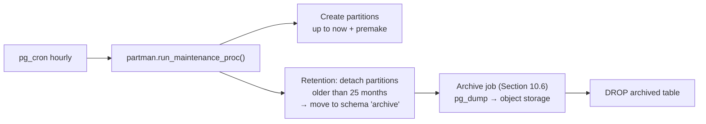

### 10.5 Verify partition pruning

```sql
EXPLAIN (COSTS OFF)
SELECT count(*) FROM pay.transactions
WHERE tenant_id = '11111111-1111-1111-1111-111111111111'
  AND created_at >= '2026-10-01' AND created_at < '2026-10-21';
```

```
 Aggregate
   ->  Index Only Scan using transactions_p20261001_tenant_id_created_at_..._idx on transactions_p20261001
         Index Cond: ((tenant_id = '...') AND (created_at >= ...) AND (created_at < ...))
```

Only **one** partition appears, so pruning worked. Watch out for patterns that defeat pruning:

```sql
-- ❌ function on the partition key → scans ALL partitions
WHERE date(created_at) = '2026-10-20'
-- ✅ sargable range
WHERE created_at >= '2026-10-20' AND created_at < '2026-10-21'

-- ❌ lookup by txn_id alone → probes every partition's PK index
SELECT * FROM pay.transactions WHERE txn_id = $1;
-- ✅ give the planner a time window (from UUIDv7, the API resource, or a reasonable bound)
SELECT * FROM pay.transactions WHERE txn_id = $1 AND created_at >= now() - interval '35 days';
```

Prepared statements with parameters get **run-time pruning**. In `EXPLAIN ANALYZE` it shows up as `Subplans Removed: N`.

### 10.6 Archive and drop old partitions

```bash
# 🟡 Run from a pod/job that can reach the primary
TABLE=archive.transactions_p20240801
pg_dump "host=pg-payments-rw dbname=payments user=migrator sslmode=require" \
        --table="$TABLE" --format=custom --compress=9 --file="/tmp/${TABLE}.dump"
aws s3 cp "/tmp/${TABLE}.dump" "s3://acme-pg-archive/payments/${TABLE}.dump" --storage-class GLACIER_IR
# verify the upload (size/checksum), keep a catalog row of what was archived, then:
psql "host=pg-payments-rw dbname=payments user=migrator" -c "DROP TABLE ${TABLE};"
```

Restoring an archived month for an audit: `pg_restore -d payments_restore /tmp/archive.transactions_p20240801.dump` into a scratch database, never straight into production.

### 10.7 Partitioning rules of thumb

1. **Every PK/UNIQUE constraint must include the partition key.** For globally unique business keys (idempotency, merchant order reference) use a separate small table, as `pay.idempotency_keys` does.
2. **Always filter on the partition key** in hot queries.
3. **Create indexes on the parent.** They cascade to all partitions, including future ones. To add an index to a huge existing partitioned table without blocking writes: `CREATE INDEX … ON ONLY parent` (invalid at first), then `CREATE INDEX CONCURRENTLY` on each partition and `ALTER INDEX parent_idx ATTACH PARTITION child_idx` for each one.
4. **Avoid updating the partition key.** It moves the row (a delete plus an insert).
5. **Keep partition counts reasonable.** Thousands of partitions slow down planning and use more lock-table memory.
6. **`ANALYZE` the parent occasionally.** Autovacuum analyzes partitions, not the parent's aggregate statistics: `ANALYZE pay.transactions;` weekly via pg_cron.

---

## 11. Query Optimization Strategies

### 11.1 The tuning loop

Never guess. Measure, change one thing, then measure again.

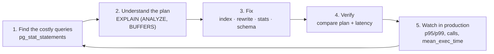

### 11.2 Find the expensive queries with `pg_stat_statements`

```sql
CREATE EXTENSION IF NOT EXISTS pg_stat_statements;   -- once per database

-- Top 10 by TOTAL time (what is costing the server the most overall)
SELECT round(total_exec_time::numeric/1000, 1)        AS total_s,
       calls,
       round(mean_exec_time::numeric, 2)              AS mean_ms,
       round(stddev_exec_time::numeric, 2)            AS stddev_ms,
       rows / NULLIF(calls,0)                          AS rows_per_call,
       round(100.0 * shared_blks_hit / NULLIF(shared_blks_hit + shared_blks_read, 0), 1) AS cache_hit_pct,
       left(regexp_replace(query, '\s+', ' ', 'g'), 120) AS query
FROM pg_stat_statements
ORDER BY total_exec_time DESC
LIMIT 10;

-- Slowest on average (user-visible latency), ignoring rare queries
SELECT calls, round(mean_exec_time::numeric,2) AS mean_ms, left(query, 120)
FROM pg_stat_statements WHERE calls > 100
ORDER BY mean_exec_time DESC LIMIT 10;

-- Queries spilling to disk (work_mem too small for them)
SELECT calls, temp_blks_written, left(query,120)
FROM pg_stat_statements WHERE temp_blks_written > 0
ORDER BY temp_blks_written DESC LIMIT 10;

-- Start a fresh measurement window after a fix
SELECT pg_stat_statements_reset();
```

> Run these on **each** instance. Replicas have their own `pg_stat_statements`, holding the read traffic.

### 11.3 Read an execution plan

```sql
SET app.tenant_id = '11111111-1111-1111-1111-111111111111';   -- psql session for testing
EXPLAIN (ANALYZE, BUFFERS, SETTINGS)
SELECT txn_id, created_at, status, amount_minor
FROM pay.transactions
WHERE tenant_id = '11111111-1111-1111-1111-111111111111'
  AND created_at >= now() - interval '7 days'
ORDER BY created_at DESC
LIMIT 50;
```

**Bad plan (before the right index):**

```
Limit  (actual time=812.4..812.5 rows=50 loops=1)
  ->  Sort  (actual time=812.4..812.4 rows=50 loops=1)
        Sort Key: created_at DESC
        Sort Method: top-N heapsort  Memory: 32kB
        ->  Seq Scan on transactions_p20261001  (actual time=0.03..790.1 rows=41210 loops=1)
              Filter: ((tenant_id = '...') AND (created_at >= ...))
              Rows Removed by Filter: 9958790        ← read 10 M rows to keep 41 K
              Buffers: shared hit=1203 read=182334   ← 182 K blocks from disk (≈1.4 GB)
Execution Time: 812.6 ms
```

**Good plan (after `ix_txn_tenant_created … INCLUDE (status, amount_minor, currency)`):**

```
Limit  (actual time=0.04..0.21 rows=50 loops=1)
  ->  Index Only Scan using transactions_p20261001_tenant_id_created_at_idx on transactions_p20261001
        Index Cond: ((tenant_id = '...') AND (created_at >= ...))
        Heap Fetches: 0                         ← visibility map is current, so heap not touched
        Buffers: shared hit=6
Execution Time: 0.25 ms                         ← 3,000× faster
```

**What to look at, in order:**

| Look for | Meaning | Typical fix |
|---|---|---|
| `Seq Scan` with large `Rows Removed by Filter` | No usable index | Add a composite/partial index |
| `rows=` estimate vs `actual rows` off by 10×+ | Bad statistics | `ANALYZE`, raise the statistics target, `CREATE STATISTICS` |
| `Buffers: read=` large | Data not in cache | Better index, covering index, more `shared_buffers` |
| `Sort Method: external merge Disk:` | Sort spilled | Index that matches `ORDER BY`, or raise `work_mem` for that query/role |
| `Nested Loop` with large `loops=` | Planner expected few rows | Fix estimates; check join indexes |
| `Heap Fetches` high on Index Only Scan | Visibility map stale | Vacuum more often (autovacuum tuning) |
| Many partitions listed | Pruning failed | Filter on the partition key, sargably |

### 11.4 Catch slow plans automatically: `auto_explain`

```yaml
# Add to the CNPG Cluster spec.postgresql
shared_preload_libraries: [pg_cron, auto_explain]
parameters:
  auto_explain.log_min_duration: "500ms"
  auto_explain.log_analyze: "on"
  auto_explain.log_buffers: "on"
  auto_explain.log_timing: "off"         # timing per node is expensive; buffers are enough
  auto_explain.log_nested_statements: "on"
  auto_explain.sample_rate: "0.1"        # sample 10% of statements to limit overhead
```

### 11.5 Index strategies (payment examples)

```sql
-- 1) COMPOSITE: equality columns first, then the range/sort column
--    Query: WHERE tenant_id = ? AND created_at >= ? ORDER BY created_at DESC
--    (refunds is not partitioned, so CONCURRENTLY works directly; see the note below for partitioned tables)
CREATE INDEX CONCURRENTLY ix_refunds_tenant_created ON pay.refunds (tenant_id, created_at DESC);

-- 2) COVERING (INCLUDE): adds payload columns so the heap is never read (Index Only Scan)
CREATE INDEX ix_txn_tenant_created ON pay.transactions (tenant_id, created_at DESC)
  INCLUDE (status, amount_minor, currency);

-- 3) PARTIAL: index only the rows a hot query needs
--    "Stuck payments" sweeper: a few thousand pending rows out of billions
CREATE INDEX ix_txn_pending ON pay.transactions (created_at)
  WHERE status IN ('INITIATED','PENDING');

-- 4) EXPRESSION: the index must match the expression in WHERE exactly
CREATE INDEX ix_customers_email ON pay.customers (tenant_id, lower(email));
SELECT * FROM pay.customers WHERE tenant_id = $1 AND lower(email) = lower($2);

-- 5) BRIN: tiny indexes for append-only, time-ordered data (events, audit)
CREATE INDEX brin_audit_created ON pay.audit_log USING brin (created_at) WITH (pages_per_range = 32);

-- 6) GIN on JSONB metadata (merchant-defined tags)
CREATE INDEX ix_orders_metadata ON pay.payment_orders USING gin (metadata jsonb_path_ops);
SELECT order_id FROM pay.payment_orders
WHERE tenant_id = $1 AND metadata @> '{"channel":"pos"}' AND created_at >= now() - interval '30 days';
```

> 🟡 **On a live, non-partitioned table always use `CREATE INDEX CONCURRENTLY`.** It doesn't block writes. It can't run inside a transaction, and if it fails it leaves an `INVALID` index you must drop: `SELECT indexrelid::regclass FROM pg_index WHERE NOT indisvalid;`. For partitioned tables, see rule 3 in Section 10.7.

**Find indexes that cost you writes but serve no reads:**

```sql
-- Unused indexes since the last stats reset (check on the primary AND all replicas before dropping!)
SELECT s.schemaname, s.relname AS table, s.indexrelname AS index,
       pg_size_pretty(pg_relation_size(s.indexrelid)) AS size, s.idx_scan
FROM pg_stat_user_indexes s
JOIN pg_index i ON i.indexrelid = s.indexrelid
WHERE s.idx_scan = 0 AND NOT i.indisunique AND NOT i.indisprimary
ORDER BY pg_relation_size(s.indexrelid) DESC;

-- Duplicate indexes (same columns in the same order)
SELECT array_agg(indexrelid::regclass) AS duplicates, indrelid::regclass AS table
FROM pg_index
GROUP BY indrelid, indkey::text, coalesce(indexprs::text,''), coalesce(indpred::text,'')
HAVING count(*) > 1;
```

### 11.6 Query rewrites that matter at scale

**a) Keyset pagination instead of `OFFSET`.** `OFFSET 100000` reads and throws away 100,000 rows.

```sql
-- ❌ slows down linearly with page number
SELECT txn_id, created_at, amount_minor FROM pay.transactions
WHERE tenant_id = $1 ORDER BY created_at DESC, txn_id DESC OFFSET 100000 LIMIT 50;

-- ✅ constant time: pass the last (created_at, txn_id) of the previous page as a cursor
SELECT txn_id, created_at, amount_minor FROM pay.transactions
WHERE tenant_id = $1
  AND created_at >= now() - interval '90 days'               -- bounds partition scan
  AND (created_at, txn_id) < ($2::timestamptz, $3::uuid)     -- row-value comparison
ORDER BY created_at DESC, txn_id DESC
LIMIT 50;
```

**b) Sargable predicates.** Keep columns bare on one side.

```sql
-- ❌  WHERE amount_minor / 100 > 5000          ✅  WHERE amount_minor > 500000
-- ❌  WHERE created_at::date = CURRENT_DATE    ✅  WHERE created_at >= CURRENT_DATE AND created_at < CURRENT_DATE + 1
-- ❌  WHERE coalesce(acquirer_ref,'') = $1      ✅  WHERE acquirer_ref = $1
```

**c) Batch writes.** One round-trip for many rows.

```sql
-- Settlement: insert thousands of items in one statement using arrays from the app
INSERT INTO pay.settlement_items (tenant_id, settlement_id, txn_id, txn_created_at, amount_minor, fee_minor)
SELECT $1, $2, t.txn_id, t.created_at, t.amount, t.fee
FROM unnest($3::uuid[], $4::timestamptz[], $5::bigint[], $6::bigint[]) AS t(txn_id, created_at, amount, fee);
-- For bulk loads (acquirer settlement files) use COPY: 10–50× faster than INSERTs
-- \copy pay.recon_staging FROM 'acquirer_2026-10-20.csv' WITH (FORMAT csv, HEADER true)
```

**d) Queue processing with `FOR UPDATE SKIP LOCKED`.** Many workers, no double delivery, no lock waits.

```sql
-- Webhook dispatcher (each worker runs this in a short transaction)
WITH next AS (
  SELECT outbox_id
  FROM pay.webhook_outbox
  WHERE status = 'PENDING' AND next_attempt_at <= now()
  ORDER BY next_attempt_at
  LIMIT 100
  FOR UPDATE SKIP LOCKED
)
UPDATE pay.webhook_outbox o
SET attempts = o.attempts + 1,
    next_attempt_at = now() + make_interval(secs => least(3600, power(2, o.attempts + 1)::int))
FROM next WHERE o.outbox_id = next.outbox_id
RETURNING o.outbox_id, o.tenant_id, o.event_type, o.payload;
-- After a successful HTTP 2xx: UPDATE ... SET status='SENT' WHERE outbox_id = ANY($1);
```

> The worker role needs to see all tenants' outbox rows. Run workers as a dedicated role with a policy such as `CREATE POLICY worker_all ON pay.webhook_outbox TO outbox_worker USING (true);`, rather than giving the API role `BYPASSRLS`.

**e) Existence checks.**

```sql
-- ❌ SELECT count(*) FROM pay.refunds WHERE tenant_id=$1 AND txn_id=$2   (counts everything)
-- ✅
SELECT EXISTS (SELECT 1 FROM pay.refunds WHERE tenant_id = $1 AND txn_id = $2);
```

**f) Approximate counts for dashboards.** Exact `count(*)` over huge tables is expensive.

```sql
SELECT reltuples::bigint AS approx_rows FROM pg_class WHERE oid = 'pay.transactions_p20261001'::regclass;
-- Per-tenant counts → use the summary tables / materialized views in Section 12
```

**g) Optimistic concurrency for state transitions.** No `SELECT … FOR UPDATE` round-trip needed:

```sql
UPDATE pay.transactions
SET status = 'CAPTURED', updated_at = now()
WHERE txn_id = $1 AND created_at = $2 AND status = 'AUTHORIZED'    -- guard = valid transition
RETURNING txn_id;   -- 0 rows → someone else already moved it, so handle idempotently
```

### 11.7 Statistics: give the planner good information

```sql
-- See what the planner believes
SELECT attname, n_distinct, null_frac, most_common_vals
FROM pg_stats WHERE schemaname='pay' AND tablename='transactions_p20261001';

-- Skewed tenant distribution? Collect a bigger sample for that column
ALTER TABLE pay.transactions ALTER COLUMN tenant_id SET STATISTICS 1000;
ANALYZE pay.transactions;

-- Correlated columns (e.g. method_type='upi' implies acquirer='npci'): tell the planner
CREATE STATISTICS st_txn_method_acq (dependencies, ndistinct, mcv)
  ON method_type, acquirer FROM pay.transactions;
ANALYZE pay.transactions;
```

### 11.8 The multi-tenant skew problem (big tenants vs small tenants)

With prepared statements, after 5 executions PostgreSQL may switch to a **generic plan** that ignores the actual `tenant_id` value. A plan that's perfect for a tiny merchant (index scan) can be terrible for your largest merchant (who needs a bitmap or parallel scan), and vice versa.

```sql
-- Diagnose: compare plans for a small and a big tenant
EXPLAIN (ANALYZE, BUFFERS) EXECUTE recent_txns('<small-tenant-uuid>');
EXPLAIN (ANALYZE, BUFFERS) EXECUTE recent_txns('<big-tenant-uuid>');

-- Fix for the reporting role (plans per execution; costs a little CPU for planning)
ALTER ROLE api_reader SET plan_cache_mode = 'force_custom_plan';
```

For OLTP point queries (`WHERE tenant_id = $1 AND txn_id = $2`) generic plans are fine and faster. Apply `force_custom_plan` only where skew hurts. The structural fix is to move very large tenants to a **dedicated cluster** (Section 3.2).

### 11.9 Write-path optimization: HOT updates and fillfactor

A **HOT (Heap-Only Tuple) update** writes the new row version on the **same page** and **skips index updates**. It only happens if (1) the page has free space and (2) **no indexed column changed**.

```sql
-- How many updates are HOT? Aim for > 90% on frequently updated tables.
SELECT relname, n_tup_upd, n_tup_hot_upd,
       round(100.0 * n_tup_hot_upd / NULLIF(n_tup_upd,0), 1) AS hot_pct
FROM pg_stat_user_tables WHERE schemaname = 'pay' ORDER BY n_tup_upd DESC;
```

Practical rules:

* **Don't index `updated_at` or `status`** on hot tables unless a query truly needs it. Each indexed column that changes kills HOT. (The partial index on `status` in Section 4 is a deliberate trade-off. Re-check it with the query above.)
* **Lower `fillfactor`** (80–90) on tables whose rows are updated after insert (`payment_orders`, `webhook_outbox`), so updates fit on the same page:

```sql
ALTER TABLE pay.webhook_outbox SET (fillfactor = 80);           -- affects newly written pages
-- For partitioned tables, set it on the partitions (or in pg_partman's template table)
```

### 11.10 Vacuum and bloat: keep tables lean

```sql
-- Tables with the most dead rows and when they were last vacuumed
SELECT relname, n_live_tup, n_dead_tup,
       round(100.0*n_dead_tup/NULLIF(n_live_tup+n_dead_tup,0),1) AS dead_pct,
       last_autovacuum, last_autoanalyze
FROM pg_stat_user_tables WHERE schemaname='pay'
ORDER BY n_dead_tup DESC LIMIT 15;

-- Per-table autovacuum for the high-churn queue table: vacuum after ~1,000 changes, not 20%
ALTER TABLE pay.webhook_outbox SET (
  autovacuum_vacuum_scale_factor = 0.0, autovacuum_vacuum_threshold = 1000,
  autovacuum_analyze_scale_factor = 0.0, autovacuum_analyze_threshold = 1000,
  autovacuum_vacuum_cost_delay = 0);

-- Purge processed queue/idempotency rows in small batches (avoid one giant DELETE)
DELETE FROM pay.idempotency_keys
WHERE ctid = ANY (ARRAY(SELECT ctid FROM pay.idempotency_keys
                        WHERE created_at < now() - interval '72 hours' LIMIT 10000));
```

> **Long-running transactions are the enemy of vacuum.** A transaction open for an hour (on the primary, or on a replica with `hot_standby_feedback=on`) prevents cleanup of *every* row changed in that hour. Monitor `pg_stat_activity.xact_start` (Section 15) and use `idle_in_transaction_session_timeout`.

If a table is already badly bloated, `VACUUM FULL` rewrites it but takes an **exclusive lock** 🔴. Use the `pg_repack` extension to rebuild online, or for partitioned tables simply wait for the partition to age out.

### 11.11 Find who is blocking whom

```sql
SELECT blocked.pid  AS blocked_pid,  left(blocked.query, 60)  AS blocked_query,
       blocking.pid AS blocking_pid, left(blocking.query, 60) AS blocking_query,
       now() - blocking.xact_start AS blocking_xact_age, blocking.state
FROM pg_stat_activity blocked
JOIN LATERAL unnest(pg_blocking_pids(blocked.pid)) AS b(pid) ON true
JOIN pg_stat_activity blocking ON blocking.pid = b.pid;

-- Last resort (🔴): cancel the query, or terminate the session
SELECT pg_cancel_backend(<pid>);     SELECT pg_terminate_backend(<pid>);
```

---

## 12. Materialized Views: Build, Refresh, Secure, Maintain

A **materialized view (MV)** stores the *result* of a query as a table. Use it for expensive aggregations that many users read but that can be a few minutes stale: merchant dashboards, daily summaries, success-rate charts.

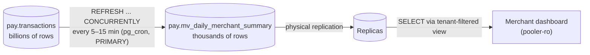

### 12.1 Create the MV

```sql
-- 🟡 As payments_owner (migrator)
CREATE MATERIALIZED VIEW pay.mv_daily_merchant_summary AS
SELECT
    t.tenant_id,
    (t.created_at AT TIME ZONE 'Asia/Kolkata')::date              AS business_date,
    t.currency,
    t.method_type,
    count(*)                                                     AS attempts,
    count(*) FILTER (WHERE t.status = 'CAPTURED')                AS captured_count,
    count(*) FILTER (WHERE t.status = 'FAILED')                  AS failed_count,
    coalesce(sum(t.amount_minor) FILTER (WHERE t.status = 'CAPTURED'), 0) AS captured_minor,
    round(100.0 * count(*) FILTER (WHERE t.status = 'CAPTURED') / count(*), 2) AS success_rate_pct,
    max(t.created_at)                                            AS last_txn_at
FROM pay.transactions t
WHERE t.created_at >= date_trunc('day', now()) - interval '90 days'    -- bound the work (and prune partitions)
  AND t.txn_type IN ('SALE','CAPTURE')
GROUP BY 1, 2, 3, 4
WITH NO DATA;                                     -- create empty; populate in the next step

-- REQUIRED for REFRESH ... CONCURRENTLY: a UNIQUE index covering every row
CREATE UNIQUE INDEX ux_mv_daily_summary
  ON pay.mv_daily_merchant_summary (tenant_id, business_date, currency, method_type);

-- First population must be non-concurrent
REFRESH MATERIALIZED VIEW pay.mv_daily_merchant_summary;
ANALYZE pay.mv_daily_merchant_summary;
```

> `now()` inside the definition is evaluated **at each refresh**, so the 90-day window slides automatically.

### 12.2 `REFRESH` vs `REFRESH … CONCURRENTLY`

| | `REFRESH MATERIALIZED VIEW` | `REFRESH MATERIALIZED VIEW CONCURRENTLY` |
|---|---|---|
| Readers during refresh | **Blocked** (ACCESS EXCLUSIVE lock) | **Not blocked** ✅ |
| Requirement | none | A unique index; the MV must already be populated |
| Speed | Faster (rebuilds) | Slower (computes a diff, then applies inserts/updates/deletes) |
| WAL / bloat | Writes the full MV | Writes only the changes, but creates dead tuples, so vacuum the MV |
| Use when | Initial load, or nobody reads during refresh | **Production dashboards** |

### 12.3 Secure the MV for multi-tenancy ⚠️

**Materialized views do not support Row-Level Security.** If you grant `SELECT` on the MV to `app_ro`, any tenant could read every tenant's totals. Expose it through a tenant-filtered view instead:

```sql
REVOKE ALL ON pay.mv_daily_merchant_summary FROM PUBLIC, app_rw, app_ro;

-- A normal view runs with the view OWNER's privileges (security_invoker = false by default),
-- so the app can read through it without touching the MV directly.
CREATE VIEW pay.v_daily_merchant_summary WITH (security_barrier = true) AS
SELECT tenant_id, business_date, currency, method_type, attempts,
       captured_count, failed_count, captured_minor, success_rate_pct, last_txn_at
FROM pay.mv_daily_merchant_summary
WHERE tenant_id = pay.current_tenant();

GRANT SELECT ON pay.v_daily_merchant_summary TO app_ro, app_rw;
GRANT SELECT ON pay.mv_daily_merchant_summary TO platform_reporting;   -- internal BI only
```

```sql
-- Dashboard query (on a replica via pooler-ro)
BEGIN;
SELECT set_config('app.tenant_id', '11111111-1111-1111-1111-111111111111', true);
SELECT business_date, method_type, captured_count, captured_minor, success_rate_pct
FROM pay.v_daily_merchant_summary
WHERE business_date >= current_date - 30
ORDER BY business_date DESC;
COMMIT;
```

### 12.4 Schedule refreshes with pg_cron and log them

```sql
-- A log table so you can see freshness and duration
CREATE TABLE pay.mv_refresh_log (
  id          bigint GENERATED ALWAYS AS IDENTITY PRIMARY KEY,
  mv_name     text NOT NULL,
  started_at  timestamptz NOT NULL,
  finished_at timestamptz,
  ok          boolean,
  error       text
);

CREATE OR REPLACE PROCEDURE pay.refresh_mv(p_mv regclass)
LANGUAGE plpgsql AS $$
DECLARE
  v_id bigint;
BEGIN
  -- Skip if another refresh of the same MV is still running (never pile up refreshes)
  IF NOT pg_try_advisory_xact_lock(hashtext(p_mv::text)) THEN
    RAISE NOTICE 'refresh of % already running, skipping', p_mv;
    RETURN;
  END IF;
  INSERT INTO pay.mv_refresh_log(mv_name, started_at) VALUES (p_mv::text, clock_timestamp())
  RETURNING id INTO v_id;
  SET LOCAL lock_timeout = '5s';
  SET LOCAL statement_timeout = '10min';
  EXECUTE format('REFRESH MATERIALIZED VIEW CONCURRENTLY %s', p_mv);
  UPDATE pay.mv_refresh_log SET finished_at = clock_timestamp(), ok = true WHERE id = v_id;
EXCEPTION WHEN OTHERS THEN
  -- the block's changes (including the start row) are rolled back; record the failure separately
  INSERT INTO pay.mv_refresh_log(mv_name, started_at, finished_at, ok, error)
  VALUES (p_mv::text, clock_timestamp(), clock_timestamp(), false, SQLERRM);
END $$;

-- Every 10 minutes, on the PRIMARY (pg_cron only runs jobs on the primary)
SELECT cron.schedule('mv-daily-summary', '*/10 * * * *',
                     $$CALL pay.refresh_mv('pay.mv_daily_merchant_summary')$$);
-- Vacuum the MV after concurrent refreshes create dead rows
SELECT cron.schedule('mv-daily-summary-vacuum', '30 * * * *',
                     $$VACUUM (ANALYZE) pay.mv_daily_merchant_summary$$);
```

**Monitor freshness:**

```sql
SELECT mv_name, max(finished_at) FILTER (WHERE ok) AS last_success,
       now() - max(finished_at) FILTER (WHERE ok) AS staleness,
       avg(finished_at - started_at) FILTER (WHERE ok AND started_at > now() - interval '1 day') AS avg_duration,
       count(*) FILTER (WHERE NOT ok AND started_at > now() - interval '1 day') AS failures_24h
FROM pay.mv_refresh_log GROUP BY mv_name;
```

Alert if `staleness > 30 min` or `failures_24h > 0`. Show `last_success` on the dashboard ("data as of 14:20").

### 12.5 Maintaining MVs over time

| Task | Command |
|---|---|
| Change the definition | MVs can't be `ALTER`ed to a new query. Create `mv_..._v2`, populate it, swap the view to point at it in one transaction, then drop v1 |
| Rename atomically | `BEGIN; ALTER MATERIALIZED VIEW pay.mv_x RENAME TO mv_x_old; ALTER MATERIALIZED VIEW pay.mv_x_v2 RENAME TO mv_x; COMMIT;` |
| Check size and bloat | `SELECT pg_size_pretty(pg_total_relation_size('pay.mv_daily_merchant_summary'));` |
| Check whether populated | `SELECT matviewname, ispopulated FROM pg_matviews WHERE schemaname='pay';` |
| Dependencies before dropping a column | `SELECT * FROM pg_depend WHERE refobjid = 'pay.transactions'::regclass AND deptype='n';`, or just try `DROP` without `CASCADE` (it errors and lists dependents) |
| Refresh is getting slow | Add an index supporting the MV query, narrow the time window, or switch to incremental rollups (12.6) |

### 12.6 When MVs aren't enough: incremental rollup tables

`REFRESH` always recomputes the **whole** 90-day window. At billions of rows, maintain a **summary table incrementally** instead, recomputing only the recent buckets:

```sql
CREATE TABLE pay.daily_summary (
  tenant_id uuid, business_date date, currency char(3), method_type text,
  attempts bigint, captured_count bigint, failed_count bigint, captured_minor bigint,
  updated_at timestamptz NOT NULL DEFAULT now(),
  PRIMARY KEY (tenant_id, business_date, currency, method_type)
);

-- Every 5 min: recompute only today and yesterday (late-arriving updates), idempotently
INSERT INTO pay.daily_summary AS s (tenant_id, business_date, currency, method_type,
                                   attempts, captured_count, failed_count, captured_minor)
SELECT tenant_id, (created_at AT TIME ZONE 'Asia/Kolkata')::date, currency, method_type,
       count(*),
       count(*) FILTER (WHERE status='CAPTURED'),
       count(*) FILTER (WHERE status='FAILED'),
       coalesce(sum(amount_minor) FILTER (WHERE status='CAPTURED'),0)
FROM pay.transactions
WHERE created_at >= (date_trunc('day', now() AT TIME ZONE 'Asia/Kolkata') - interval '1 day') AT TIME ZONE 'Asia/Kolkata'
  AND txn_type IN ('SALE','CAPTURE')
GROUP BY 1,2,3,4
ON CONFLICT (tenant_id, business_date, currency, method_type) DO UPDATE
SET attempts = EXCLUDED.attempts, captured_count = EXCLUDED.captured_count,
    failed_count = EXCLUDED.failed_count, captured_minor = EXCLUDED.captured_minor,
    updated_at = now()
WHERE (s.attempts, s.captured_count, s.failed_count, s.captured_minor)
      IS DISTINCT FROM (EXCLUDED.attempts, EXCLUDED.captured_count, EXCLUDED.failed_count, EXCLUDED.captured_minor);
```

Because `daily_summary` is a **normal table**, you can put RLS on it directly. It also scales to any history length, since old days are never recomputed.

| | Materialized view | Incremental rollup table |
|---|---|---|
| Simplicity | ✅ one statement | More code |
| Refresh cost | Whole window every time | Only recent buckets |
| RLS | ❌ needs wrapper view | ✅ native |
| Best for | Up to roughly tens of millions of source rows per refresh | Billions of rows, long history |

---

## 13. PostgreSQL Performance Tuning for High Load

### 13.1 Where the memory goes

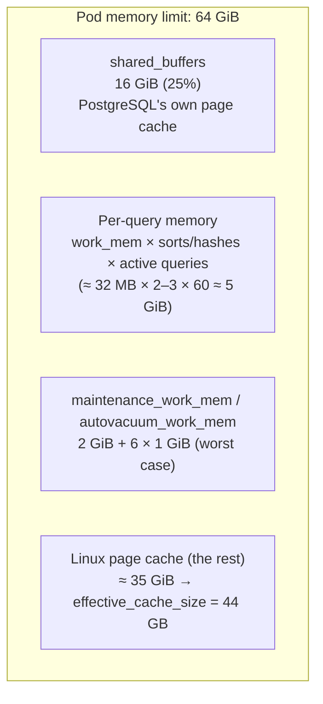

> **Kubernetes rule:** everything (shared_buffers + per-backend memory + page cache pressure) counts against the **pod memory limit**. If the pod exceeds it, the kernel OOM-kills PostgreSQL, which means a crash and a failover. Keep `shared_buffers` at ≤ 25–30% of the limit and be conservative with `work_mem`.

### 13.2 The parameters, explained, for three node sizes

| Parameter | What it does | 8 vCPU / 32 GiB | **16 vCPU / 64 GiB** | 32 vCPU / 128 GiB | Restart? |
|---|---|---|---|---|---|
| `shared_buffers` | PostgreSQL buffer cache | 8GB | **16GB** | 32GB | Yes |
| `effective_cache_size` | Planner hint: total cache (shared_buffers + OS cache). Allocates nothing | 22GB | **44GB** | 90GB | No |
| `work_mem` | Memory per sort/hash *operation*, so one query can use several | 16MB | **32MB** | 64MB | No |
| `maintenance_work_mem` | `CREATE INDEX`, `VACUUM`, `ALTER TABLE ADD FK` | 1GB | **2GB** | 4GB | No |
| `autovacuum_work_mem` | Memory per autovacuum worker | 512MB | **1GB** | 2GB | No |
| `huge_pages` | Uses 2 MB pages for shared memory, cutting TLB misses | try | **try** (or `on` with K8s hugepages) | on | Yes |
| `max_connections` | Hard cap on backends. Keep low; use PgBouncer | 200 | **400** | 600 | Yes |
| `wal_buffers` | WAL write buffer | 32MB | **64MB** | 128MB | Yes |
| `wal_compression` | Compresses full-page images in WAL (less IO and network) | lz4 | **lz4** | zstd | No |
| `max_wal_size` | WAL between checkpoints; bigger means fewer, smoother checkpoints | 8GB | **16GB** | 32GB | No |
| `min_wal_size` | WAL kept for reuse | 2GB | **4GB** | 8GB | No |
| `checkpoint_timeout` | Max time between checkpoints | 15min | **15min** | 15min | No |
| `checkpoint_completion_target` | Spread checkpoint IO across the interval | 0.9 | **0.9** | 0.9 | No |
| `random_page_cost` | Cost of a random read relative to sequential (SSD ≈ 1.1) | 1.1 | **1.1** | 1.1 | No |
| `effective_io_concurrency` | Concurrent IO for bitmap heap scans (SSD) | 200 | **200** | 300 | No |
| `default_statistics_target` | Histogram detail for the planner | 200 | **200** | 200 | No |
| `max_worker_processes` | Pool for all background workers | 12 | **24** | 40 | Yes |
| `max_parallel_workers` | Max parallel query workers in total | 6 | **12** | 24 | No |
| `max_parallel_workers_per_gather` | Per query. Keep small for OLTP | 2 | **4** | 4 | No |
| `max_parallel_maintenance_workers` | Parallel `CREATE INDEX` / vacuum | 2 | **4** | 8 | No |
| `jit` | JIT compilation; adds latency to short OLTP queries | off | **off** | off | No |
| `autovacuum_max_workers` | Concurrent autovacuum workers | 4 | **6** | 8 | Yes (≤ 17) |
| `autovacuum_naptime` | How often the launcher checks each DB | 15s | **15s** | 10s | No |
| `autovacuum_vacuum_scale_factor` | Vacuum when dead rows > X% of table | 0.05 | **0.05** | 0.02 | No |
| `autovacuum_vacuum_insert_scale_factor` | Vacuum insert-only tables (sets visibility map for index-only scans) | 0.05 | **0.05** | 0.05 | No |
| `autovacuum_vacuum_cost_limit` | Vacuum IO budget; raise on fast SSDs | 1000 | **2000** | 4000 | No |
| `synchronous_commit` | Durability of commits (see 13.4) | on | **on** | on | No |
| `idle_in_transaction_session_timeout` | Kills sessions idle inside a transaction | 60s | **60s** | 60s | No |
| `track_io_timing` | IO timing in EXPLAIN and pg_stat_statements | on | **on** | on | No |
| `log_min_duration_statement` | Log slow statements | 250ms | **250ms** | 250ms | No |

> CNPG manages some parameters itself (for example `wal_level`, `hot_standby`, `max_wal_senders`, `archive_command`, `listen_addresses`) and rejects attempts to override them. That's expected.

### 13.3 Apply and verify changes on Kubernetes

```bash
# 🟡 Edit the parameters in 20-cluster.yaml, then:
$ kubectl apply -f 20-cluster.yaml
# Reloadable params apply within seconds. Params that need a restart trigger a ROLLING restart:
# standbys first, then a switchover, then the old primary.
$ kubectl cnpg status pg-payments -n payments-db
```

```sql
-- Confirm the effective values and whether any change is waiting for a restart
SELECT name, setting, unit, source, pending_restart
FROM pg_settings
WHERE name IN ('shared_buffers','work_mem','max_connections','max_wal_size','random_page_cost')
   OR pending_restart;
```

### 13.4 Durability vs latency, per transaction

`synchronous_commit` can be changed **per transaction**, so you can keep money movements fully durable and relax only non-critical writes:

| Value | Commit waits for | Data at risk on crash | Use for |
|---|---|---|---|
| `remote_apply` | Standby has **applied** the change (visible on the replica) | None | Read-your-writes on replicas |
| **`on`** (default with sync standbys) | Standby has **flushed** the WAL to disk | None | **All money movement** ✅ |
| `remote_write` | Standby has received it (OS buffer) | Tiny window if both nodes crash at once | Rarely worth it |
| `local` | Local flush only | Loss on failover | Audit/analytics writes |
| `off` | Nothing (async flush ~600 ms later) | Last ~600 ms of commits | Never for payments |

```sql
-- Non-critical analytics event: skip waiting for the standby (it's still crash-safe locally)
BEGIN;
SET LOCAL synchronous_commit = local;
INSERT INTO pay.audit_log (tenant_id, actor, action) VALUES ($1, 'api', 'dashboard.viewed');
COMMIT;
```

### 13.5 Checkpoints and WAL health

```sql
-- PostgreSQL 17+: checkpoint stats moved to pg_stat_checkpointer
SELECT num_timed, num_requested,
       round(100.0 * num_requested / NULLIF(num_timed + num_requested, 0), 1) AS pct_requested,
       write_time, sync_time, buffers_written
FROM pg_stat_checkpointer;
```

If `pct_requested` is high (above ~10%), checkpoints are triggered by WAL volume rather than by the timer. **Raise `max_wal_size`.** Also watch the logs for `checkpoints are occurring too frequently`.

```sql
-- WAL generation rate (run twice, 60 s apart, and subtract)
SELECT pg_current_wal_lsn(), now();
-- bytes/s = pg_wal_lsn_diff(lsn2, lsn1) / 60  → size max_wal_size ≈ 2–3 × (WAL per checkpoint_timeout)
```

### 13.6 Cache efficiency

```sql
SELECT datname,
       round(100.0 * blks_hit / NULLIF(blks_hit + blks_read, 0), 2) AS cache_hit_pct,
       xact_commit, xact_rollback, deadlocks, temp_files, pg_size_pretty(temp_bytes) AS temp
FROM pg_stat_database WHERE datname = 'payments';
```

A healthy OLTP target is **> 99%**. A lower number means the hot working set doesn't fit in memory: add RAM, partition to shrink hot indexes, or remove unnecessary indexes.

### 13.7 Kubernetes-level tuning

| Area | Recommendation |
|---|---|
| **QoS** | `requests == limits` for CPU and memory → *Guaranteed* QoS, the last to be evicted |
| **CPU** | With the kubelet's static CPU manager policy plus integer CPU requests, Postgres gets dedicated cores (no throttling jitter) |
| **Huge pages** | Pre-allocate on nodes; request `hugepages-2Mi: 17Gi` in `resources` and set `huge_pages: on` |
| **Storage** | Provisioned-IOPS SSD or local NVMe; XFS; separate WAL volume; test with `fio` before go-live |
| **Node OS** | Transparent Huge Pages = `never` / `madvise`; no swap; tune via your node image or a privileged DaemonSet |
| **Noisy neighbours** | Dedicated, tainted node pool; one Postgres instance per node |
| **Network** | Instances in the same region across AZs; inter-AZ round-trip adds directly to sync-commit latency (typically 0.5–2 ms) |

> **PostgreSQL 18 note:** 18 adds asynchronous I/O (`io_method = worker` by default, or `io_uring` on supported kernels), which speeds up sequential scans, bitmap heap scans and vacuum. If you start fresh on 18, benchmark both `io_method` values on your storage.

### 13.8 Load test before you trust any number

```bash
# Built-in benchmark: initialise ~1.5 GB of sample data and run 64 clients for 5 minutes
$ pgbench -h pooler-payments-rw -U api_user -i -s 100 payments_bench
$ pgbench -h pooler-payments-rw -U api_user -c 64 -j 8 -T 300 -P 10 --protocol=prepared payments_bench
```

A payment-shaped custom script (`payment.sql`):

```sql
\set tenant random(1, 500)
\set amt random(100, 500000)
BEGIN;
SELECT set_config('app.tenant_id', (SELECT tenant_id::text FROM pay.tenants ORDER BY tenant_id OFFSET :tenant - 1 LIMIT 1), true) \gset
INSERT INTO pay.transactions (tenant_id, order_id, txn_type, status, amount_minor, currency, method_type)
VALUES (current_setting('app.tenant_id')::uuid, gen_random_uuid(), 'SALE', 'CAPTURED', :amt, 'INR', 'upi');
COMMIT;
```

```bash
$ pgbench -h pooler-payments-rw -U api_user -n -f payment.sql -c 100 -j 10 -T 600 -P 10 payments
# Record TPS and latency p95/p99 (add --log / -r for per-statement latency) before and after every change.
```

---

## 14. Backups, Point-in-Time Recovery and Disaster Recovery

### 14.1 The strategy

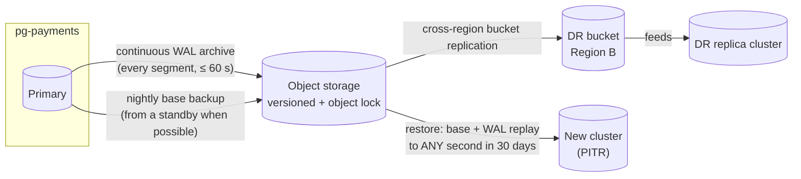

| Layer | Protects against | RPO | RTO |
|---|---|---|---|
| Sync standbys (same region) | Node/zone failure | 0 | ~30 s (automatic) |
| WAL archive + base backups (PITR) | Human error, bad deploy, corruption, ransomware | ≤ 60 s (or to the exact second before the mistake) | Minutes to hours (size-dependent) |
| DR replica cluster (other region) | Region loss | Seconds | Minutes (manual promotion) |
| Immutable bucket (object lock) | Attacker deleting backups | — | — |

### 14.2 Scheduled and on-demand backups

```yaml
# 50-scheduled-backup.yaml
apiVersion: postgresql.cnpg.io/v1
kind: ScheduledBackup
metadata: { name: pg-payments-nightly, namespace: payments-db }
spec:
  schedule: "0 30 20 * * *"            # 6-field cron (with seconds): 20:30 UTC = 02:00 IST
  backupOwnerReference: self
  immediate: true                      # also take one right after creation
  target: prefer-standby               # read the data from a standby, sparing the primary
  cluster: { name: pg-payments }
  method: plugin
  pluginConfiguration:
    name: barman-cloud.cloudnative-pg.io
```

```bash
$ kubectl apply -f 50-scheduled-backup.yaml

# On-demand backup before a risky change
$ kubectl cnpg backup pg-payments -n payments-db \
    --method plugin --plugin-name barman-cloud.cloudnative-pg.io
$ kubectl -n payments-db get backups
$ kubectl -n payments-db describe backup <backup-name>      # phase: completed
```

> CNPG also supports **Kubernetes VolumeSnapshot** backups (`method: volumeSnapshot`), which are very fast for multi-TB databases on clouds with CSI snapshots. Combine them with WAL archiving to the object store for PITR.

### 14.3 Point-in-Time Recovery: undo a mistake

Scenario: at **14:32 IST** a bad deploy ran `UPDATE pay.transactions SET status='FAILED'` without a `WHERE`. You restore a **new** cluster to 14:31:59 and copy the correct data back.

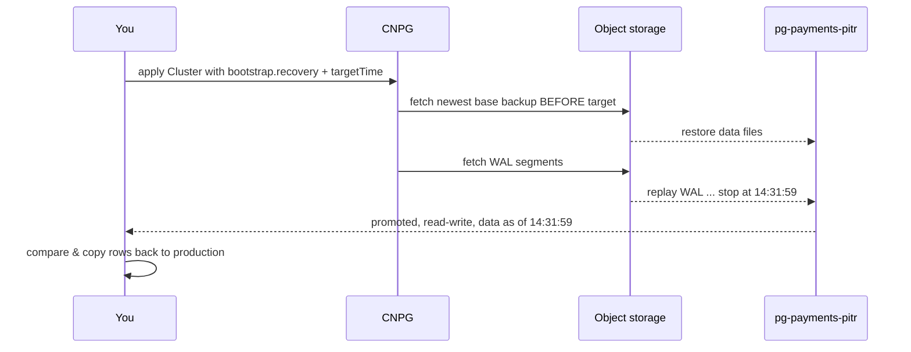

```yaml
# 60-pitr-restore.yaml (a NEW cluster; production keeps running)
apiVersion: postgresql.cnpg.io/v1
kind: Cluster
metadata: { name: pg-payments-pitr, namespace: payments-db }
spec:
  instances: 1
  imageName: registry.example.com/db/postgresql-payments:17-1
  storage: { storageClass: pg-fast, size: 1Ti }
  walStorage: { storageClass: pg-fast, size: 200Gi }
  bootstrap:
    recovery:
      source: origin
      recoveryTarget:
        targetTime: "2026-10-20 14:31:59.000000+05:30"
  externalClusters:
    - name: origin
      plugin:
        name: barman-cloud.cloudnative-pg.io
        parameters:
          barmanObjectName: pg-payments-store
          serverName: pg-payments
```

```bash
$ kubectl apply -f 60-pitr-restore.yaml
$ kubectl -n payments-db logs -f -l cnpg.io/cluster=pg-payments-pitr
$ kubectl cnpg psql pg-payments-pitr -n payments-db -- -d payments \
    -c "SELECT status, count(*) FROM pay.transactions WHERE created_at >= current_date GROUP BY 1;"
```

Then export the correct rows (for example `\copy (SELECT txn_id, created_at, status FROM pay.transactions WHERE …) TO 'fix.csv'`) and apply a targeted `UPDATE … FROM` on production. Delete the PITR cluster afterwards.

> Other recovery targets: `targetLSN`, `targetXID`, `targetName` (a restore point you created with `SELECT pg_create_restore_point('before_release_42');`, which is a great habit before every risky migration), or `targetImmediate`.

### 14.4 Prove your backups work (monthly)

An untested backup is a hope, not a backup.

1. Restore the latest backup to a scratch cluster with the PITR manifest (target = now).
2. Run integrity checks:

```sql
-- B-tree index consistency (amcheck ships with PostgreSQL)
CREATE EXTENSION IF NOT EXISTS amcheck;
SELECT bt_index_check(index => c.oid, heapallindexed => true)
FROM pg_index i JOIN pg_class c ON c.oid = i.indexrelid
JOIN pg_am am ON am.oid = c.relam
WHERE am.amname = 'btree' AND c.relnamespace = 'pay'::regnamespace AND c.relkind = 'i';
-- Ledger must balance: debits = credits per journal
SELECT journal_id FROM pay.ledger_entries
GROUP BY journal_id
HAVING sum(CASE direction WHEN 'D' THEN amount_minor ELSE 0 END)
    <> sum(CASE direction WHEN 'C' THEN amount_minor ELSE 0 END)
LIMIT 10;   -- expect zero rows
```

3. Record the **actual RTO** (restore duration) and compare it with your target.
4. Run `pg_checksums --check` offline on a restored copy, or rely on `data_checksums=on` errors surfacing in logs (`SELECT checksum_failures FROM pg_stat_database;`).

### 14.5 Logical exports per tenant (offboarding, legal requests)

```bash
psql "host=pooler-payments-ro dbname=payments user=bi_user sslmode=require" -c \
 "\copy (SELECT * FROM pay.transactions WHERE tenant_id = '…' AND created_at >= '2026-01-01') TO 'tenant_txns.csv' CSV HEADER"
```

---

## 15. Monitoring and Alerting

### 15.1 Wire up Prometheus

```yaml
# 70-monitoring.yaml
apiVersion: monitoring.coreos.com/v1
kind: PodMonitor
metadata: { name: pg-payments, namespace: payments-db }
spec:
  selector: { matchLabels: { cnpg.io/cluster: pg-payments } }
  podMetricsEndpoints: [{ port: metrics }]          # 9187
---
apiVersion: monitoring.coreos.com/v1
kind: PodMonitor
metadata: { name: pg-payments-poolers, namespace: payments-db }
spec:
  selector: { matchExpressions: [{ key: cnpg.io/poolerName, operator: Exists }] }
  podMetricsEndpoints: [{ port: metrics }]          # 9127
---
# Custom business metrics: CNPG runs these queries and exports the results
apiVersion: v1
kind: ConfigMap
metadata:
  name: pg-payments-custom-metrics
  namespace: payments-db
  labels: { cnpg.io/reload: "" }
data:
  custom-queries: |
    payments_mv:
      query: |
        SELECT mv_name, EXTRACT(EPOCH FROM now() - max(finished_at)) AS staleness_seconds
        FROM pay.mv_refresh_log WHERE ok GROUP BY mv_name
      target_databases: ["payments"]
      primary: true
      metrics:
        - mv_name: { usage: "LABEL", description: "Materialized view" }
        - staleness_seconds: { usage: "GAUGE", description: "Seconds since last successful refresh" }
    payments_default_partition:
      query: |
        SELECT c.relname AS partition, c.reltuples::bigint AS approx_rows
        FROM pg_class c WHERE c.relnamespace = 'pay'::regnamespace AND c.relname LIKE '%\_default'
      target_databases: ["payments"]
      primary: true
      metrics:
        - partition: { usage: "LABEL", description: "Default partition" }
        - approx_rows: { usage: "GAUGE", description: "Rows in default partition (should be 0)" }
```

Reference the ConfigMap from the Cluster:

```yaml
spec:
  monitoring:
    customQueriesConfigMap:
      - name: pg-payments-custom-metrics
        key: custom-queries
```

Import the official CloudNativePG Grafana dashboard (published in the `cloudnative-pg/grafana-dashboards` repository) for replication, WAL, backups, connections and pooler views.

### 15.2 Alerts that matter for a payment database

> Metric names below match recent CNPG releases. Confirm them against your version with `curl <pod>:9187/metrics` before relying on them.

```yaml
apiVersion: monitoring.coreos.com/v1
kind: PrometheusRule
metadata: { name: pg-payments-alerts, namespace: payments-db }
spec:
  groups:
    - name: pg-payments
      rules:
        - alert: PGInstanceDown
          expr: cnpg_collector_up{cluster="pg-payments"} == 0
          for: 1m
          labels: { severity: critical }
        - alert: PGReplicationLagHigh
          expr: max by (pod) (cnpg_pg_replication_lag{cluster="pg-payments"}) > 30
          for: 2m
          labels: { severity: warning }
        - alert: PGWALArchivingStalled
          expr: cnpg_pg_stat_archiver_seconds_since_last_archival{cluster="pg-payments"} > 300
          for: 5m
          labels: { severity: critical }       # PITR and DR are at risk
        - alert: PGXIDWraparoundRisk
          expr: max(cnpg_pg_database_xid_age{cluster="pg-payments"}) > 1000000000
          for: 10m
          labels: { severity: critical }
        - alert: PGConnectionsNearLimit
          expr: sum by (pod) (cnpg_backends_total{cluster="pg-payments"}) > 320    # 80% of 400
          for: 5m
          labels: { severity: warning }
        - alert: PgBouncerClientsWaiting
          expr: max(cnpg_pgbouncer_pools_cl_waiting) > 10
          for: 2m
          labels: { severity: warning }
        - alert: PaymentsMVStale
          expr: max(cnpg_payments_mv_staleness_seconds) > 1800
          for: 5m
          labels: { severity: warning }
        - alert: PaymentsDefaultPartitionNotEmpty
          expr: max(cnpg_payments_default_partition_approx_rows) > 0
          for: 15m
          labels: { severity: warning }
        - alert: PGVolumeAlmostFull
          expr: kubelet_volume_stats_available_bytes{namespace="payments-db"} / kubelet_volume_stats_capacity_bytes{namespace="payments-db"} < 0.15
          for: 10m
          labels: { severity: critical }
```

### 15.3 SQL health-check pack (bookmark this)

```sql
-- 1) Connections by state (watch 'idle in transaction')
SELECT usename, application_name, state, count(*)
FROM pg_stat_activity WHERE backend_type = 'client backend'
GROUP BY 1,2,3 ORDER BY 4 DESC;

-- 2) Long-running transactions and queries (> 1 min)
SELECT pid, usename, state, now() - xact_start AS xact_age, now() - query_start AS query_age,
       wait_event_type, wait_event, left(query, 100) AS query
FROM pg_stat_activity
WHERE xact_start < now() - interval '1 minute' AND backend_type = 'client backend'
ORDER BY xact_start;

-- 3) Transaction ID wraparound headroom (autovacuum must keep this far below 2 billion)
SELECT datname, age(datfrozenxid) AS xid_age,
       round(100.0 * age(datfrozenxid) / 2000000000, 1) AS pct_to_wraparound
FROM pg_database ORDER BY 2 DESC;

SELECT c.oid::regclass AS table, age(c.relfrozenxid) AS xid_age,
       pg_size_pretty(pg_total_relation_size(c.oid)) AS size
FROM pg_class c WHERE c.relkind IN ('r','m','t')
ORDER BY age(c.relfrozenxid) DESC LIMIT 10;

-- 4) Biggest tables and indexes
SELECT c.oid::regclass AS relation, c.relkind, pg_size_pretty(pg_total_relation_size(c.oid)) AS total
FROM pg_class c WHERE c.relnamespace = 'pay'::regnamespace AND c.relkind IN ('r','p','m','i')
ORDER BY pg_total_relation_size(c.oid) DESC LIMIT 15;

-- 5) Wait events right now (what are sessions waiting on?)
SELECT wait_event_type, wait_event, count(*)
FROM pg_stat_activity WHERE state = 'active' GROUP BY 1,2 ORDER BY 3 DESC;

-- 6) Replication and archiving: see Sections 6.5 and 8.1
```

---

## 16. Day-2 Operations Runbook

### 16.1 Routine schedule

| Frequency | Task | How |
|---|---|---|
| **Daily** | Cluster, replication and backup status | `kubectl cnpg status pg-payments` |
| Daily | Review alerts, slow-query log, `pg_stat_statements` top 10 | Section 11.2 |
| Daily | Check default partitions are empty and MVs are fresh | Sections 10.4, 12.4 |
| **Weekly** | Dead tuples / bloat, unused indexes, `ANALYZE` partitioned parents | Sections 11.5, 11.10, 10.7 |
| Weekly | Capacity trend: disk growth, WAL rate, connections | Grafana |
| **Monthly** | Restore test with integrity checks | Section 14.4 |
| Monthly | Planned switchover (proves failover paths work) | Section 8.3 |
| Monthly | Apply PostgreSQL minor release | Section 16.2 |
| **Quarterly** | Full failover drill, DR-region drill, password/cert rotation | Sections 8.4, 8.9 |
| Yearly | Major version upgrade plan | Section 16.3 |

### 16.2 Minor version upgrade (e.g. 17.5 → 17.6)

Minor releases are bug and security fixes. Same data format, no dump/restore.

```bash
# 1. Rebuild your custom image from the new base tag and push it (Section 7.4)
# 2. Point the cluster at it
$ kubectl -n payments-db patch cluster pg-payments --type merge \
    -p '{"spec":{"imageName":"registry.example.com/db/postgresql-payments:17.6-1"}}'
# 3. CNPG performs a rolling update: standbys → switchover → old primary
$ watch -n 5 kubectl cnpg status pg-payments -n payments-db
```

### 16.3 Major version upgrade (e.g. 17 → 18)

Two options, both rehearsed in staging first:

| Approach | Downtime | How |
|---|---|---|
| **Blue/green with logical replication** ✅ | Seconds (cutover) | Create a new 18 cluster (`bootstrap.initdb` with schema import), publish from 17 to 18 with logical replication, let it catch up, stop writes, flip the poolers/DNS. CNPG supports this declaratively with `Publication` / `Subscription` resources |
| **In-place `pg_upgrade`** | Minutes (offline) | Recent CNPG versions can run an offline in-place major upgrade when you change `imageName` to a new major. Check the "Upgrades" section of the docs for your version and take a backup first |

### 16.4 Common changes

```bash
# Grow storage (the StorageClass must allow expansion)
$ kubectl -n payments-db patch cluster pg-payments --type merge -p '{"spec":{"storage":{"size":"1500Gi"}}}'

# Rotate an application password (CNPG applies it to the managed role)
$ kubectl -n payments-db create secret generic pg-role-api_user --type=kubernetes.io/basic-auth \
    --from-literal=username=api_user --from-literal=password="$(openssl rand -base64 24)" \
    --dry-run=client -o yaml | kubectl apply -f -
# Roll the app pods so they pick up the new secret

# Reload or restart instances
$ kubectl cnpg reload  pg-payments -n payments-db
$ kubectl cnpg restart pg-payments -n payments-db                 # rolling restart of all instances
```

### 16.5 Zero-downtime schema changes (expand → migrate → contract)

| Change | Safe way |
|---|---|
| Add nullable column, or column with a constant default | `ALTER TABLE … ADD COLUMN x text DEFAULT 'a';` is instant (metadata only, PG 11+) |
| Add `NOT NULL` | `ADD CONSTRAINT x_nn CHECK (x IS NOT NULL) NOT VALID;` → `VALIDATE CONSTRAINT x_nn;` (no long lock) → `SET NOT NULL` (uses the validated check, so it's fast) |
| Add foreign key | `ADD CONSTRAINT … FOREIGN KEY … NOT VALID;` then `VALIDATE CONSTRAINT …;` |
| Add index | `CREATE INDEX CONCURRENTLY` (partitioned tables: Section 10.7 rule 3) |
| Rename/drop column | Deploy code that stops using it → drop in a later release. Never rename in one step |
| Change column type | Add a new column, backfill in batches, switch reads, drop the old one |
| Every DDL | `SET lock_timeout = '3s';` and retry, so a migration never queues behind a long query and blocks all traffic behind it |

### 16.6 Incident playbooks

| Symptom | First checks | Likely fix |
|---|---|---|
| **Writes failing, "read-only transaction"** | `kubectl cnpg status`: is a failover in progress? | Wait ~30 s; confirm the app connects via `-rw` pooler; verify retry logic |
| **Writes hang** | `pg_stat_replication` empty? `dataDurability: required` with no healthy standby | Restore a standby (`kubectl cnpg destroy … N` to re-clone). Only if the business accepts it, temporarily switch to `preferred` |
| **Replica lag climbing** | Long queries on the replica (`max_standby_streaming_delay`), IO saturation, network | Cancel long reports; move BI to a dedicated replica; check disk IOPS |
| **Disk full (WAL volume)** | `pg_replication_slots` retained WAL; `pg_stat_archiver.failed_count` | Fix the archive destination/credentials; drop orphaned slots; expand the volume |
| **Too many connections** | `pg_stat_activity` by `usename`/`application_name`; pooler `cl_waiting` | Find the leaking or slow app; lower app pool sizes; never just raise `max_connections` |
| **Sudden slowness** | `pg_stat_statements` diff, wait events, locks (Section 11.11), recent deploy/migration | Roll back the query or index change; `ANALYZE` after bulk loads |
| **XID wraparound warning** | Query 15.3 #3; long transactions or abandoned replication slots blocking freeze | Kill blockers, then `VACUUM (FREEZE, VERBOSE)` on the oldest tables |

---

## 17. Scaling Beyond One Cluster

One well-tuned PostgreSQL primary on modern hardware handles **tens of thousands of simple OLTP transactions per second**. When you approach its limits (CPU, WAL throughput, storage size or blast radius), scale out by **tenant cells**:

```mermaid
flowchart TB
    GW["API Gateway / Payment API"] --> ROUTER{"Tenant router<br/>(cached tenant_directory)"}
    ROUTER -->|"tenants on shard 1"| C1["Cell 1<br/>pooler-rw / pooler-ro<br/>pg-payments-01 (3 nodes)"]
    ROUTER -->|"tenants on shard 2"| C2["Cell 2<br/>pg-payments-02 (3 nodes)"]
    ROUTER -->|"dedicated: BigMerchant"| C3["Cell 3<br/>pg-payments-bigmerchant (3 nodes)"]
    DIRDB[("Control-plane DB<br/>tenant_directory<br/>(small HA cluster)")] -.-> ROUTER
    C1 --> OBJ[("Object storage")]
    C2 --> OBJ
    C3 --> OBJ
```

```sql
-- Control-plane database: the source of truth for where each tenant lives
CREATE TABLE tenant_directory (
  tenant_id   uuid PRIMARY KEY,
  cell        text NOT NULL,                 -- 'pg-payments-01'
  rw_dsn      text NOT NULL,                 -- pooler-rw address for that cell
  ro_dsn      text NOT NULL,
  state       text NOT NULL DEFAULT 'active' CHECK (state IN ('active','migrating','readonly')),
  updated_at  timestamptz NOT NULL DEFAULT now()
);
```

**Moving one tenant between cells with logical replication** (PostgreSQL 15+ supports row filters):

```sql
-- On the SOURCE cell (publish_via_partition_root lets one filter cover all partitions)
CREATE PUBLICATION move_tenant_abc
  FOR TABLE pay.customers, pay.payment_orders, pay.transactions, pay.ledger_entries
  WHERE (tenant_id = 'aaaaaaaa-0000-0000-0000-000000000abc')
  WITH (publish_via_partition_root = true);
-- (Row filters require the filtered column to be part of the replica identity for UPDATE/DELETE,
--  e.g. ALTER TABLE ... REPLICA IDENTITY FULL, or include tenant_id in the primary key.)

-- On the TARGET cell (schema already deployed there)
CREATE SUBSCRIPTION move_tenant_abc
  CONNECTION 'host=pg-payments-01-rw dbname=payments user=replicator_logical sslmode=require'
  PUBLICATION move_tenant_abc;
-- Wait for catch-up, set the tenant to 'readonly' in tenant_directory, confirm zero lag,
-- flip its cell, re-enable writes, drop the subscription, then delete the tenant's rows from the source.
```

**Alternatives:** the **Citus** extension turns PostgreSQL into a distributed database sharded by `tenant_id` (a natural fit for this schema), at the cost of more operational complexity. Cells keep each cluster a plain, well-understood PostgreSQL. That's why many payment companies choose them.

---

## 18. Production Readiness Checklist

**Architecture & HA**

- [ ] 3 instances across 3 availability zones, `podAntiAffinityType: required`
- [ ] Quorum synchronous replication, `dataDurability: required`
- [ ] Dedicated, tainted database node pool; Guaranteed QoS
- [ ] Failover drill done and RTO measured; app retries idempotent operations
- [ ] DR replica cluster in a second region; promotion runbook rehearsed

**Durability & recovery**

- [ ] `dataChecksums: true`; `fsync`/`full_page_writes` untouched (on)
- [ ] Continuous WAL archiving healthy; `archive_timeout` ≤ 60 s
- [ ] Nightly base backups; 30-day retention; versioned + object-locked bucket
- [ ] Monthly restore test with amcheck and the ledger-balance check passing
- [ ] Restore points created before risky releases

**Multi-tenancy & security**

- [ ] `tenant_id` on every tenant table, first in indexes and keys
- [ ] RLS `ENABLE` + `FORCE` on all tenant tables; app roles `NOBYPASSRLS`; no grants on partitions
- [ ] Materialized views exposed only through tenant-filtered views
- [ ] TLS everywhere (`sslmode=verify-full`), NetworkPolicies, `enableSuperuserAccess: false`
- [ ] No card numbers (PANs) stored, only vault tokens; encryption at rest; secrets in a secret manager
- [ ] `pgaudit` (or equivalent) enabled for privileged actions, per your PCI DSS scope

**Performance**

- [ ] PgBouncer `rw` and `ro` poolers in transaction mode; pool budget documented
- [ ] Reads routed to replicas; money decisions read from the primary
- [ ] Partitioning with pg_partman + pg_cron; default partitions monitored
- [ ] Indexes reviewed against `pg_stat_statements`; no unused or duplicate indexes
- [ ] Parameters tuned for the node size; load-tested at **2× expected peak**
- [ ] Role-level `statement_timeout`, `lock_timeout`, `idle_in_transaction_session_timeout`

**Operations**

- [ ] All manifests in Git (GitOps: Argo CD / Flux); no hand edits in production
- [ ] Prometheus metrics, Grafana dashboards, alerts routed to on-call
- [ ] Runbooks for the incidents in Section 16.6
- [ ] Minor upgrades monthly; major upgrade plan documented

---

## 19. Appendix: Command Cheat Sheet

```bash
# ---------- CloudNativePG ----------
kubectl cnpg status   pg-payments -n payments-db [--verbose]
kubectl cnpg psql     pg-payments -n payments-db -- -d payments
kubectl cnpg promote  pg-payments pg-payments-2 -n payments-db       # switchover
kubectl cnpg restart  pg-payments -n payments-db                     # rolling restart
kubectl cnpg reload   pg-payments -n payments-db
kubectl cnpg backup   pg-payments -n payments-db --method plugin --plugin-name barman-cloud.cloudnative-pg.io
kubectl cnpg fencing  on|off pg-payments pg-payments-3 -n payments-db
kubectl cnpg destroy  pg-payments 3 -n payments-db                   # re-clone a broken instance
kubectl -n payments-db get cluster,pooler,backup,scheduledbackup
kubectl -n payments-db patch cluster pg-payments --type merge -p '{"spec":{"instances":4}}'
```

```sql
-- ---------- Replication ----------
SELECT application_name, state, sync_state, replay_lag FROM pg_stat_replication;      -- primary
SELECT pg_is_in_recovery(), now() - pg_last_xact_replay_timestamp();                  -- standby
SELECT slot_name, active, wal_status FROM pg_replication_slots;
SELECT pg_promote();                                     -- manual promotion (non-operator setups)
SELECT pg_wal_replay_pause(); SELECT pg_wal_replay_resume();
SELECT pg_create_restore_point('before_release_42');

-- ---------- Performance ----------
SELECT * FROM pg_stat_statements ORDER BY total_exec_time DESC LIMIT 10;
EXPLAIN (ANALYZE, BUFFERS) <query>;
SELECT pid, now()-xact_start, state, left(query,80) FROM pg_stat_activity ORDER BY xact_start;
SELECT pg_cancel_backend(pid);  SELECT pg_terminate_backend(pid);
SELECT relname, n_dead_tup, last_autovacuum FROM pg_stat_user_tables ORDER BY n_dead_tup DESC;

-- ---------- Partitions & jobs ----------
CALL partman.run_maintenance_proc();
SELECT * FROM partman.check_default(p_exact_count := true);
SELECT * FROM cron.job;  SELECT * FROM cron.job_run_details ORDER BY start_time DESC LIMIT 20;

-- ---------- Materialized views ----------
REFRESH MATERIALIZED VIEW CONCURRENTLY pay.mv_daily_merchant_summary;
SELECT matviewname, ispopulated FROM pg_matviews;
```

---

### Where to go next

* CloudNativePG documentation: <https://cloudnative-pg.io/documentation/current/> (Architecture, Replication, Backup, Replica clusters, Connection pooling, Monitoring)
* PostgreSQL manual: High Availability, Load Balancing and Replication: <https://www.postgresql.org/docs/current/high-availability.html>
* PostgreSQL manual: Table Partitioning: <https://www.postgresql.org/docs/current/ddl-partitioning.html>
* pg_partman: <https://github.com/pgpartman/pg_partman> · pg_cron: <https://github.com/citusdata/pg_cron>
* PgBouncer configuration: <https://www.pgbouncer.org/config.html>

*Every number in this guide is a starting point. Your load tests and your monitoring are the final authority.*
