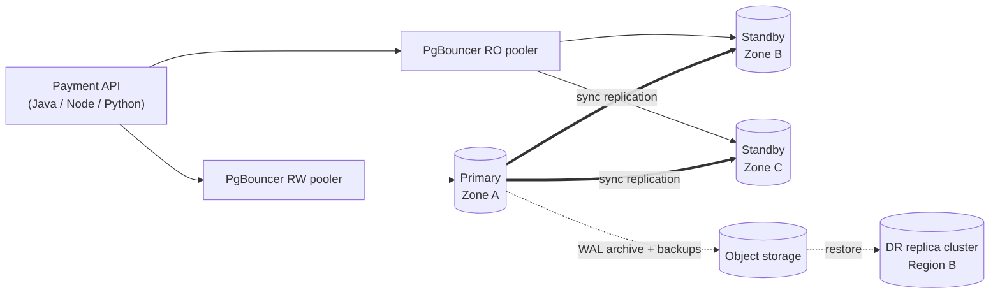

# HA Multi-Tenant PostgreSQL for a Payment Gateway: Guide

A step-by-step, beginner-friendly guide to designing, deploying and operating a **production-ready, highly available, multi-tenant PostgreSQL** database on **Docker and Kubernetes**. A **payment gateway** is the worked example throughout.

📄 **Main document:** [`PostgreSQL-HA-MultiTenant-Payments-Guide.md`](./PostgreSQL-HA-MultiTenant-Payments-Guide.md)

---

## Who it's for

* DBAs and backend engineers who are **new to running PostgreSQL in production**
* Teams building **multi-tenant SaaS / payment platforms** that need high data volumes, low-latency transactions and zero data loss
* Developers working in **Java, Node.js or Python** (application examples are given in all three)

You should be comfortable with basic SQL and have used `docker` and `kubectl` a little.

---

## What you'll build



* A **3-instance PostgreSQL cluster** across 3 availability zones, managed by the **CloudNativePG** operator
* **Quorum synchronous replication** (RPO = 0) with automatic failover
* **PgBouncer** connection pooling with read/write splitting
* **Shared-schema multi-tenancy** enforced by **Row-Level Security**
* **Monthly partitioning** automated with `pg_partman` + `pg_cron`
* **Continuous backups**, point-in-time recovery and a **cross-region DR cluster**
* **Monitoring and alerting** with Prometheus and Grafana

---

## Contents at a glance

| # | Section | You'll learn |
|---|---|---|
| 1 | Core Concepts Primer | WAL, replication, sync vs async, RPO/RTO, failover, split-brain |
| 2 | Target Architecture | How all the components fit together |
| 3 | Multi-Tenancy Design | Shared tables vs schema vs database per tenant; hybrid tiers |
| 4 | Payment Gateway Data Model | Tables, keys, indexes, roles and Row-Level Security |
| 5 | Load Distribution | Routing writes to the primary and reads to replicas (Java, Node, Python code) |
| 6 | Hands-On Docker Lab | Build replication by hand: standby, promotion, `pg_rewind`, delayed standby |
| 7 | Kubernetes with CloudNativePG | Operator install, custom image, production `Cluster` manifest |
| 8 | Standbys & Replicas | Scale, switchover, failover drills, fencing, slots, DR replica cluster |
| 9 | Connection Pooling | Pool sizing math, PgBouncer modes, `Pooler` manifests, monitoring |
| 10 | Partitioning | Range partitions, pruning, `pg_partman`, retention and archiving |
| 11 | Query Optimization | `pg_stat_statements`, `EXPLAIN`, index strategies, rewrites, tenant skew, HOT updates, vacuum |
| 12 | Materialized Views | Create, refresh concurrently, secure for multi-tenancy, schedule, incremental rollups |
| 13 | Performance Tuning | Parameter tables for 3 node sizes, durability trade-offs, K8s tuning, `pgbench` |
| 14 | Backups, PITR & DR | Scheduled backups, point-in-time restore, restore testing |
| 15 | Monitoring & Alerting | `PodMonitor`, custom metrics, `PrometheusRule` alerts, SQL health checks |
| 16 | Day-2 Runbook | Upgrades, schema changes without downtime, incident playbooks |
| 17 | Scaling Beyond One Cluster | Tenant cells, a tenant directory, moving tenants with logical replication |
| 18 | Production Readiness Checklist | Go-live checklist |
| 19 | Command Cheat Sheet | The commands you'll use every day |

The guide includes **21 Mermaid diagrams**. They render natively on GitHub, GitLab, VS Code (with a Mermaid extension), Obsidian and most modern Markdown viewers.

---

## Payment gateway tables covered

`tenants` · `api_keys` · `customers` · `payment_methods` · `payment_orders`* · `transactions`* · `transaction_events`* · `ledger_entries`* · `audit_log`* · `idempotency_keys` · `webhook_outbox` · `refunds` · `settlements` · `settlement_items` · `mv_daily_merchant_summary` (materialized view) · `daily_summary` (rollup)

\* partitioned by month

---

## Technology and versions

| Component | Version / note |
|---|---|
| PostgreSQL | **17** baseline (notes for 18 where relevant) |
| Kubernetes operator | **CloudNativePG** (install via Helm) |
| Backups | Barman Cloud plugin → S3 / GCS / Azure Blob / MinIO |
| Pooling | PgBouncer (CNPG `Pooler`, or standalone) |
| Extensions | `pg_stat_statements`, `pg_partman` 5.x, `pg_cron`, `auto_explain`, `amcheck` |
| Local practice | Docker Compose (Section 6), `kind` (Section 7.2) |

> Operator and plugin versions are shown as `${VERSION}` placeholders on purpose. Check the release pages for the current versions before you install.

---

## Suggested learning path

1. **Read Sections 1–5** to understand the concepts and the data model.
2. **Do the Docker lab (Section 6)** on your laptop. It takes about 1–2 hours and teaches you what the operator automates.
3. **Create a `kind` cluster** and deploy Sections 7–9 locally.
4. **Load the schema** (Section 4), then practise partitioning, query tuning and materialized views (Sections 10–12).
5. **Tune, back up, restore and monitor** (Sections 13–15) in a staging environment.
6. **Before go-live:** run failover and restore drills, load-test at 2× expected peak, and complete the Section 18 checklist.

---

## Quick start: the Docker lab

```bash
mkdir -p ~/pg-ha-lab && cd ~/pg-ha-lab
# Copy init-primary.sh, standby-entrypoint.sh and docker-compose.yml from Section 6 of the guide
chmod +x init-primary.sh standby-entrypoint.sh
docker compose up -d
docker exec -it pg-primary psql -U postgres -d payments \
  -c "SELECT application_name, state, sync_state FROM pg_stat_replication;"
```

## Quick start: Kubernetes

```bash
helm repo add cnpg https://cloudnative-pg.github.io/charts && helm repo update
helm upgrade --install cnpg cnpg/cloudnative-pg -n cnpg-system --create-namespace
kubectl create namespace payments-db
# Create the secrets (7.5), then apply the manifests from Sections 7, 9, 14 and 15:
kubectl apply -f 10-objectstore.yaml -f 20-cluster.yaml -f 40-pooler-rw.yaml -f 41-pooler-ro.yaml
kubectl cnpg status pg-payments -n payments-db
```

---

## Validation status

| Part | Status |
|---|---|
| SQL (schema, RLS, partitioning, queries, MVs, rollups, health checks) | ✅ Executed against PostgreSQL 16 with `pg_partman` 5.0 and `pg_cron` 1.6 |
| PostgreSQL 17-only queries (e.g. `pg_stat_checkpointer`) | ⚠️ Not executed (written for 17+) |
| YAML (Compose, CNPG, Prometheus, app config) | ✅ Syntax-checked |
| Mermaid diagrams | ✅ All 21 render |
| Docker lab and Kubernetes manifests | ⚠️ Not run end-to-end. Try them in a lab or staging environment first |

---

## Important notes

* **Treat the numbers as starting points.** Tuning values, pool sizes and alert thresholds must be validated with load tests on your own hardware.
* **Security.** Replace all example passwords, keep secrets in a secret manager, and never store card numbers (PANs). Store vault tokens only, per PCI DSS.
* **Test in staging first.** Try every destructive command (🔴 in the guide) in a non-production environment before you use it in production.

---

## References

* [CloudNativePG documentation](https://cloudnative-pg.io/documentation/current/)
* [PostgreSQL: High Availability, Load Balancing and Replication](https://www.postgresql.org/docs/current/high-availability.html)
* [PostgreSQL: Table Partitioning](https://www.postgresql.org/docs/current/ddl-partitioning.html)
* [pg_partman](https://github.com/pgpartman/pg_partman) · [pg_cron](https://github.com/citusdata/pg_cron)
* [PgBouncer configuration](https://www.pgbouncer.org/config.html)
